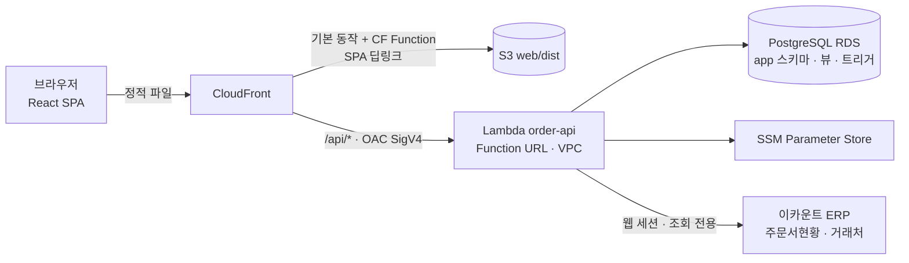

# KD order

- 한 줄 요약: Google Apps Script + 스프레드시트로 돌던 사내 주문·견적·정산 업무 도구를 **React(TypeScript) + AWS Lambda + PostgreSQL** 웹앱으로 다시 만들고, 주문 데이터 원천인 **이카운트 ERP**와의 자동 수집을 붙인 프로젝트.

## 프로젝트 개요

| 항목 | 내용 |
|---|---|
| 무엇 | 주문 · 견적 · 정산(대리점 수수료) · 입금 관리를 한 화면에서 처리하는 사내 업무 도구 「KD Order」의 리뉴얼 |
| 목적 | 운영 중인 GAS 웹앱(구글 시트 기반)을 대체할 새 앱 구축. 이카운트에서 사람이 엑셀을 내려받아 옮기던 일을 자동화하고, 배송처 판별·중복주문·발송상태 같은 업무 규칙을 DB/도메인 계층에 일원화 |
| 사용자 | 영업팀 · 경영팀 · MBL팀 · 공장(발송 담당) · 배송처 담당 등 사내 직원 (커밋 메시지의 요청·피드백 출처 기준) |
| 기간 | 2026-09-03 ~ 2026-10-16 |
| 내 커밋 수 | 126건 (전 브랜치, 머지 제외) |
| 역할 | 리뉴얼 앱 단독 개발 — 프런트엔드 · 백엔드 API · DB 스키마/마이그레이션 · AWS 배포 · 이카운트 연동 · 기존 데이터 이관 · 현업 피드백 대응. 저장소의 다른 작성자 커밋은 2026-09-03 초기 업로드 4건뿐 |
| 저장소 | github.com/rapha155/kd-order (원본: github.com/shhyeong/kd-order, 로컬 `C:\src\_dev\kd-order`) |
| 개발 방식 | 일부 커밋에 Claude Code 세션 트레일러가 있어 AI 코딩 도구를 함께 사용한 것으로 보임 |

## 배경과 문제 정의

### 기존 운영 방식 (GAS + 구글 스프레드시트)
- **수작업 데이터 수집**: 주문 원천은 이카운트 ERP인데, 사람이 [주문서현황]에서 엑셀을 내려받아 시트/앱에 옮겨야 했다(README, `docs/13`, `docs/15`). 이카운트에는 주문서 조회 Open API가 없음을 실측으로 확인(`7801eeb`).
- **업무 규칙 분산**: 발송상태(취소 포함)처럼 같은 질문에 화면마다 다른 답을 내던 규칙이 있었다(`ad2b9f0` «화면마다 달랐던 답을 한 곳으로»). 배송처 판별·중복주문·대리점 판정 기준도 시트와 스크립트 곳곳에 흩어져 있어, 리뉴얼하면서 경영팀·MBL팀 확인을 받아 문서로 확정했다(`e6c8dc1`, `dbaad66`, `48a39c3`).
- **데이터 품질**: 줄여 적은 학교명 때문에 배송처 「정보없음」이 731건, 주문No.가 중복·공백이라 키로 쓸 수 없었다(`c7e8f74`, `bf6aa03`).
- **기록의 분산**: 변경이력·발송 기록이 각각 다른 시트에 있어 새 시스템에서 이어 보려면 이관이 필요했다(`7b97629`, `be84d30`).
- **성능·확장 한계**: 시트 기반 집계 대신 DB를 택한 이유를 «조건에 맞는 것을 찾아 모아 세는 일»(부분 검색·집계·행끼리 비교)로 정리(`docs/02-why-postgres.md`).

### 목표
1. 이카운트 주문서·거래처 수집을 사람 손에서 프로그램으로 옮긴다.
2. 배송처·발송상태·대리점 판정 같은 업무 규칙을 DB 뷰/함수 한 곳에 둔다.
3. 운영 중인 GAS 앱의 화면 구성·정보 구조는 유지한 채(`docs/00-renewal-plan.md`), React + AWS 스택으로 옮기고 기존 데이터를 잃지 않고 이관한다.

### Before → After

| 구분 | Before (GAS · 스프레드시트) | After (KD Order 리뉴얼) |
|---|---|---|
| 주문서 수집 | 이카운트에서 엑셀 내려받아 수동 반영 | 관리자 화면에서 기간 선택 → 이카운트 자동 조회 → 미리보기 → 적재 (`c24cce4`) |
| 거래처 수집 | 수동 관리 + 직접등록 시트 | 거래처 마스터 9,554건 적재 + 이카운트 거래처 자동수집 (`0060664`, `e73daa7`) |
| 업무 규칙 위치 | 시트 수식·스크립트·화면에 분산 | PostgreSQL 뷰/함수(`v_order` 등) + 번호 매긴 마이그레이션 `sql/00`~`sql/52` |
| 주문 식별자 | 주문No.(중복 17건·공백 1건) | 유일한 일자-No.(전표번호), 표시 번호 분리 (`bf6aa03`) |
| 변경이력 | 시트 | `audit_log` 테이블로 이관 (5,588건) (`a4a5ac8`) |
| 문서 출력 | GAS 인쇄 | 견적서·비교견적·출고의뢰서·발송 리스트·입금 보고서 PDF, 주문목록·정산 Excel |
| 배포 환경 | Google Apps Script 웹앱 | CloudFront + S3 + Lambda(VPC) + RDS PostgreSQL |

## 기술 스택

| 구분 | 기술 |
|---|---|
| 프런트엔드 | React 19, TypeScript 5.7, Vite 6, React Router 7, date-fns, react-day-picker, @phosphor-icons/react |
| 스타일 | 플레인 CSS 디자인 시스템 (`design-system/tokens.css` · `base.css` · `app.css` · `print.css`) — SCSS/Tailwind/CSS-in-JS 미사용 원칙 |
| 엑셀/문서 | SheetJS(`xlsx`) — 서버 적재 파싱, 클라이언트 Excel 내보내기(동적 import), 브라우저 인쇄 창 기반 PDF(견적서·출고의뢰서·발송 리스트·입금 보고서) |
| 백엔드 | Node.js(≥24, ESM) AWS Lambda `order-api`, `pg`(node-postgres), `@aws-sdk/client-ssm`, `node:test` 단위 테스트 |
| DB | PostgreSQL (AWS RDS, 로컬 → EC2 점프 호스트 터널) — 번호 매긴 SQL 마이그레이션 `sql/00` ~ `sql/52`, 뷰(`v_order`, `v_commission`, `v_deposit` 등)·함수·트리거 |
| 인프라 | AWS Lambda Function URL(VPC, AWS_IAM 인증) + CloudFront OAC, CloudFront Functions(SPA 딥링크), S3 정적 호스팅, SSM Parameter Store |
| 배포/운영 스크립트 | PowerShell (`web/deploy.ps1`, `lambda/order-api/deploy.ps1`·`provision.ps1`, `sql/run-schema.ps1`), Node 스크립트(`scripts/*.mjs`) |
| 외부 연동 | 이카운트(ECOUNT) ERP — 웹 세션 기반 주문서현황·거래처 조회(조회 전용) |
| 레거시 | Google Apps Script + Google Sheets (`apps-script/`, 현행 운영 앱) |

## 아키텍처 / 구조

- **프런트(`web/src`) — 클린 아키텍처 4계층**: `presentation`(화면·모달·패널) → `application`(유스케이스·인쇄 문서 생성) → `domain`(엔티티·업무 규칙: 포장 판정, 긴급/중요, 마감임박, 견적 예산 자동조정 등) ← `infrastructure`(목/HTTP 어댑터). 목 → 실서버 교체는 `infrastructure/container.ts` 한 곳.
- **백엔드(`lambda/order-api/src`)** 도 `domain`(엑셀 격자 → 주문) / `application`(적재 유스케이스, 포트 주입) / `infrastructure`(PostgreSQL 저장소, xlsx, 이카운트 클라이언트)로 분리.
- **업무 규칙의 단일 원본을 DB 뷰/함수에 둠**: 배송처 결정 순서, 발송완료 판정(`app.is_full_shipment_only`), 발송상태(취소 포함), 대리점 판정 등 — 화면은 `v_order`를 받아 보여 주기만 하도록 설계.
- 화면: 로그인 · 주문 목록 · 견적서(작성/이력) · 비교견적(작성/이력) · 수의시담 · 입금관리 · 관리자(주문서 · 거래처 · 배송처 · 계정 · 정산 탭).

## 주요 기능

> 아래 화면은 모두 로컬 개발 서버의 **목(mock) 데이터**로 캡처했다(실거래 데이터 아님). 관리자 계정 기준.

### 주문 목록

- 지연·마감임박·긴급·중요·배송처변경·확인필요 칩과 발송상태(대기중·준비중·완료·취소), 「대리점 주문」 칩으로 걸러 본다.
- 어떤 열로 정렬해도 긴급·중요 주문이 위에 덩어리로 남는다(`6b55ede`, `7f7afa6`).
- 중복주문 검사, 금일 발송 리스트·발송완료 확인, 주문목록 PDF/Excel 내려받기(`612b9b9`, `e1cec94`).
- 행 단위로 검수·전표·입금 체크, 발송이력·메모·비고 편집(계정 권한별로 열림).

### 모바일 주문 목록 (390px)

- 1023px 이하에서 표가 거래처명·출하No.·납기일자 중심으로 줄고, 터치 컨트롤은 44px 토큰을 쓴다(`27fcdaf`, `9c40649`).

### 견적서 작성

- 수신 거래처를 검색해 고르고, S2B 학교장터 / G2B 조달청 단가 기준을 선택한 뒤 단가마스터 353개 품목에서 검색해 담는다(`6bcb89c`, `90662b8`).
- 단가가 VAT 포함 판매가이므로 합계에서 공급가액·부가세를 역산한다(`3afa3b7`). 예산을 넣으면 합계를 자동으로 깎아 맞춘다.
- PDF로 인쇄하면 이력에 저장되고, 최근 30일 같은 거래처 중복 발송을 알린다. 이력에서 수정(같은 번호)·복사(새 번호) 가능(`3c56a11`, `77174a2`).

### 비교견적

- 품목 칩을 눌러 담으면 무선센서 3사 단가 합계와 차액이 바로 계산되고, 비교표 PDF와 이력으로 남는다(`883e58c`).

### 입금관리

- 입금 칸을 체크한 날짜 기준으로 기간 조회, 전체/대리점 합계, PDF 보고서 출력. 지정된 계정만 볼 수 있다(`56564ee`).

### 관리자 — 주문서 불러오기

- 기간만 고르면 이카운트 주문서현황을 서버가 직접 조회한다. 엑셀 파일 업로드도 같은 미리보기 → 확인 → 적재 흐름을 탄다(`c24cce4`, `c00f61a`).
- 이카운트에서 사라진 주문은 확인 없이 적재하지 않는다(`139768f`).

### 관리자 — 배송처 확인

- 같은 이름의 거래처가 여러 곳이라 배송지를 자동으로 정하지 못한 주문만 모아, 맞는 주소를 골라 확정한다(`e73daa7`).

### 관리자 — 대리점 정산

- 이번 달/지난 달/전체 기간 단추, 미완료(전표·입금 미처리)만 보기, 발송·전표·입금 O/X와 처리일 표시, Excel 내보내기(`297eb3e`, `a9d5749`, `8ab1c42`).

## 내가 한 일

### 1. 새 앱 기반 구축 (2026-09-03 ~ 09-04)
- 기존 GAS 소스를 `apps-script/`로 정리하고, 디자인 토큰 단일 원본(플레인 CSS) 추가 — `22866cf`, `8437a54` (09-03)
- GAS 웹앱 구성을 React + 클린 아키텍처로 이식(화면 7종 · 모달 14종, 목 데이터로 동작) — `6ab3706` (09-03)
- PostgreSQL 앱/도메인 스키마와 `run-schema.ps1`(SSM에서 비밀번호를 읽어 psql stdin으로만 전달) — `5748ac5` (09-03), 채번 스키마 `f7909b5` (09-04)
- CloudFront OAC 뒤에서 도는 Lambda `order-api`(VPC, 계정 관리 아이디 기준 판정, 일회용 bootstrap-admin) — `c056e40` (09-04)
- 목 → 실제 API 전환 HTTP 어댑터(`HttpRepositories`), SPA 딥링크를 CloudFront 함수로 처리 — `5e4b3f9`, `099c80b` (09-04)
- 관리자 화면 신설(주문서 업로드 · 거래처 업로드 · 계정 관리 탭), 운영 빌드가 목 데이터로 조용히 배포되던 사고를 빌드 단계에서 차단 — `95f3a13` (09-04)

### 2. 주문 데이터 적재 · 이카운트 연동
- 주문서 엑셀 적재를 domain/application/infrastructure로 나눠 구현(테스트 45개), 미리보기 → 확인 → 적재 2단계 업로드 화면 — `18d240c`, `c00f61a` (09-04)
- 반복 전체 기간 재적재를 위한 스키마 보강(`missing_since` 표시, 업로드 기간·집계) — `8ca9b5d`; «사라짐» 판정은 서버에서도 확인 없이 적재 거부 — `139768f` (09-04)
- 주문 키를 주문No. → 일자-No.(전표번호)로 교체하고 표시용 번호 분리 — `bf6aa03`, `b274111`, `0564fa7` (09-04)
- 거래처 마스터 9,554건 적재(키를 거래처코드로, 삭제 대신 `in_use=false`), 직접등록 거래처 73건 이관 — `0060664`, `0b9bfd4` (09-04)
- 이카운트 주문서 조회 API 부재를 실측·명세서로 확정해 문서화 — `7801eeb` (09-04)
- **이카운트 주문서현황 자동 수집**: 웹 로그인·내부 전송 형식(KeyPack)을 재현하는 조회 전용 클라이언트와 테스트, 관리자 화면 [이카운트에서 불러오기] — `c24cce4` (09-07)
- 이카운트 거래처 자동수집, 동명 거래처 배송처 확인 화면, 주문 합계를 이카운트 원본 값으로 저장 — `e73daa7` (09-08)
- 이카운트 진행상태가 「완료」로 바뀌면 전표 자동 체크(sql/35) — `0471fe5` (09-14). 앞서 발송완료 기준으로 붙였다가 업무 피드백으로 되돌림 — `317cd0a`
- 이카운트에서 사라진 주문을 목록·정산에서 제외하고 반복 동의 요청 제거 — `336f0bf`, `2bd7139` (10-15)

### 3. 배송처 판별 · 데이터 정합성
- 줄여 적은 학교명(○○중 → ○○중학교) 꼬리 규칙 매칭으로 주소 찾기, 앞글자 매칭 오매칭(안동중 → 안동중앙고) 배제 — `c7e8f74`, `6d0e47b` (09-04); 「정보없음」 731 → 487건
- 배송처에 거래처 정식명 표시(이름·주소를 같은 행에서) — `e9aee7d` (09-04)
- 이카운트 주문서의 배송처를 주소 결정 순서에 추가(`looks_like_address`로 기관명 구분) — `849ac1e` (09-09)
- 대리점 직발송/학교 직발송 판별(이카운트 배송처가 대리점 자기 주소인지로 구분), 「배송처확인」이 배송처명을 바꾸던 문제 수정 — `b66a92e`, `1a2ed09` (09-11)
- 이카운트 배송처가 사이트 등록값보다 나중에 바뀌면 이카운트를 우선(`app.site_dest_superseded()`, sql/34) — `cce5636` (09-14)
- 배송처 전화번호가 주소를 따라가게, 이카운트 배송처와 다른지 표시(sql/49) — `012cc31` (10-13); 거래처 휴대폰 칸 추가 — `caf373d` (09-28)

### 4. 주문 목록 운영 기능
- 계정 권한(역할 4종, 권한 칸 세분화), 중복주문 판정(30일 창), 주문 취소, 대리점 정산 패널 — `6128e24` (09-04); 계정 권한 세 칸 추가 — `ce5c791` (09-10)
- 반응형 주문 목록(1023px 이하 터치 컨트롤 44px 토큰) — `27fcdaf` (09-07)
- 진행상태 열(대기중·준비중·완료, 완료는 발송이력에서 유도) — `ad81497` (09-09); 발송이력·준비중 일괄 처리 — `61ddee6` (09-10)
- 발송이력 «다 나갔다» 판정을 «남은 물량이 적혀 있는가» 기준으로 재정의, 옛 시트 774건으로 회귀 검증 — `1baf3c5` (09-10); 「~만 발송」·「선출고」 예외 추가 — `dcb8d82` (10-15)
- 정렬에서 긴급·중요 덩어리 유지 — `7f7afa6`; 발송이력 날짜순 정렬 — `5d03ff0` (09-11); 출하No. 자연 정렬 — `e2349bb` (09-16)
- 중복주문 「확인함」 체크(묶음이 아닌 주문 단위 저장) — `a54426f` (09-11)
- 발송상태에 「취소」를 상태로 추가(sql/39) — `ad2b9f0`; 발송상태별 조회·「필터·정렬 해제」 — `d296f09` (09-16)
- 금일 발송 필요 리스트 출력 · 출력 시점 명단 스냅숏으로 발송완료 확인(sql/40) — `612b9b9` (09-16)
- 공장 메모 칸 · 주문목록 PDF/Excel 내려받기(xlsx 동적 import) — `e1cec94` (09-16)
- 발송완료 건 회수·재처리 요청(좁은 권한 액션) → 사유를 비고에 기록하도록 재설계, 행 잠금 추가 — `91e473d`, `682662a` (09-17)
- 「대리점 주문」 필터 칩 — `3261e2e` (10-13); 선택 막대 하단 고정·맨 위로 버튼 — `49784be` (10-15)

### 5. 견적서 · 비교견적
- 견적 단가마스터 353개 적재 스크립트 — `6bcb89c` (09-11)
- 견적서 이력(인쇄 = 저장, 최근 30일 같은 거래처 중복 발송 알림) — `3c56a11` (09-11)
- 부가세 이중 부과 수정(단가가 이미 VAT 포함) — `3afa3b7` (09-11)
- 수신 칸 거래처 검색·최근 보낸 곳, 공급자 정보·직접 추가 복원, 넓은 품목 선택 창 — `90662b8`, `caa307e`, `debbccd` (09-11)
- 견적서 직인 삽입(이미지 최적화, 인쇄 창용 data URI) — `de0f0d1` (09-14); 직인 원본 이미지는 저장소에서 제외 — `401dc6c` (09-16)
- 무선센서 3사 비교견적표 작성 · PDF · 이력(sql/36) — `883e58c` (09-15); G2B 분류번호 — `56564ee` (09-15)
- 견적서 이력에서 수정(같은 번호)·복사(새 번호), 통합 검색, 「내 견적만」 — `77174a2` (10-16)

### 6. 정산 · 입금 관리
- 대리점 정산 화면 레이아웃 개선(기간 단추, 결론 줄) — `297eb3e`; 조회 성능 22.9초 → 0.12초 — `673ccfc` (09-11)
- 정산 Excel 내보내기, O/X 표시 — `a9d5749` (09-17); 대리점 미지정 목록 · 전표/입금 처리일 — `8ab1c42` (09-18); 전건 포함으로 전환 — `f1dc6c8` (09-22)
- 입금관리 탭(체크한 날 기준 조회, 합계, PDF), 체크보기 전용 권한 — `56564ee` (09-15)

### 7. 레거시 데이터 이관
- 변경이력 시트 → `audit_log` 이관 스크립트(시각 +09 고정, 멱등) — `7b97629` (09-04)
- 이관 누락 898줄 복구(한 자리 시(時) 파싱), 체크 칸 되맞춤 — `a4a5ac8` (09-11); 이력 65 → 5,588건
- 발송관리 시트 1~6월 발송 기록 607건 발송이력으로 이관 — `be84d30` (09-14)

### 8. 인증 · 모바일 · 화면 품질
- 세션 12시간 → 7일 + 슬라이딩 갱신, 401 시 로그인 화면으로 — `25a4acd` (09-07)
- 휴대폰 편집 모달(100dvh) — `b1ef9ce` (09-07); 390px 기준 모바일 정리·견적서 탭 통합 — `9c40649`, `fa7c1c1` (09-15)
- 변경이력 표 CSS 명시도 문제, 주문목록 칸 폭·정렬 실측 조정 — `8f71ff3`, `b0483be` (09-11)

## 기술적 문제 해결 사례

### 1. 대리점 정산 조회 22.9초 → 0.12초 (`673ccfc`, 2026-09-11)
- **문제**: 대리점 정산 화면이 로딩만 돌았다. 전체 기간 조회 22,877ms(885행).
- **원인**: `app.resolve_client_address()`가 거래처 1만여 행을 양방향 부분 일치(`'이름' LIKE '%c.name%'`)로 훑어 1회 9.2ms이고, 인덱스로 줄일 수 없는 형태. 뷰가 한 행에 이 함수를 두 번 호출(989행 × 2 × 9.2ms).
- **해결**: ① 학교 거래처는 호출 생략 ② 결과를 CTE에 담아 1회만 호출 ③ 이름 → 주소 캐시 테이블(`app.commission_address`)과 문장 단위 트리거(트랜잭션당 1회)로 캐시 갱신. 캐시에 없으면 그 자리에서 계산해 결과 정확성은 유지.
- **결과**: 0.12초(앱 계정 102ms). 기존 뷰를 되살려 두 뷰의 모든 칸을 양방향 `EXCEPT`로 비교해 차이 0행 확인.

### 2. 1년치 주문서 적재가 막히던 문제 — 키 재설계와 일괄 쓰기 (`bf6aa03`, `b274111`, `0919618`, 2026-09-04)
- **문제**: 1년치 파일(5,000줄)에서 오류 68건으로 적재가 통째로 막혔고, 건별 쓰기로는 Lambda 타임아웃(30초)에 닿을 규모였다.
- **원인**: 주문No.가 17건 중복·1건 공백이라 키가 될 수 없었고(서로 다른 주문이 합쳐짐), 꼬리 판정이 정상 행 454행을 잘라냈다. 쓰기는 주문마다 upsert + DELETE + INSERT로 왕복 약 15,000회.
- **해결**: 키를 유일한 일자-No.(전표번호)로 바꾸고 화면 번호는 별도로 표시. 이카운트 값 검증은 오류 → 경고로 낮춤(«거울이지 심판이 아니다»). 쓰기는 500행 단위 upsert, 품목 DELETE 1회(`= ANY($1)`), 1,000행 단위 INSERT로 묶고 PostgreSQL 바인드 파라미터 상한(65,535) 내로 분할. 3,000건 시나리오 테스트로 품목 교체 호출이 주문 수와 무관하게 1회임을 고정.
- **결과**: 오류 68 → 0건(경고 109건), 5,000줄 · 주문 1,768건 누락 없이 적재.

### 3. CloudFront OAC + Lambda Function URL 연동의 함정 (`5e4b3f9`, `099c80b`, `c00f61a`, `8ae9793`, 2026-09-04)
- **문제**: 본문 있는 요청이 403 `InvalidSignatureException`, API의 403/404가 HTML 200으로 덮여 프런트에 도착, 큰 엑셀 업로드 시 의미 없는 「HTTP 413」.
- **원인**: Function URL은 서명되지 않은 페이로드를 거부(`x-amz-content-sha256` 필요), OAC가 `Authorization` 헤더를 SigV4 서명에 사용, 배포 단위 CustomErrorResponses가 `/api/*`까지 적용, Function URL 본문 한도 6MB(base64 약 1.37배).
- **해결**: 공용 `HttpClient`가 본문 해시 헤더를 붙이고 세션 토큰은 `x-order-auth`로 전송. SPA 딥링크는 기본 동작(S3)에만 붙는 CloudFront 함수로 대체. 파일 선택 시점에 크기를 검사하고 413을 한국어 메시지로 변환.
- **결과**: CORS 없이 같은 도메인 `/api`로 운영, API 오류 코드가 그대로 전달됨. 함정은 문서(`90544cf`)로 남김.

### 4. 조회 API가 없는 이카운트에서 주문서·거래처 자동 수집 (`7801eeb`, `c24cce4`, `e73daa7`, 2026-09-04 ~ 09-08)
- **문제**: 주문 원천은 이카운트인데 사람이 매번 엑셀을 내려받아 올려야 했다.
- **원인**: 경로 후보 139개 호출이 모두 404, 명세서에도 주문서 조회 API가 없음을 실측으로 확인(Open API는 등록만 존재).
- **해결**: 브라우저 HAR 분석으로 웹 로그인(`spasswd` 생성 규칙)과 내부 전송 형식 KeyPack을 번들 원문 기준으로 재현한 **조회 전용** 클라이언트를 구현하고, 결과를 기존 엑셀 적재와 같은 격자 → 미리보기 → 적재 경로로 연결. 비밀번호·`spasswd`는 로그 마스킹.
- **결과**: 관리자 화면에서 기간만 고르면 주문서현황·거래처를 불러와 적재. 이후 진행상태 값도 받아 전표 자동 체크에 활용(`0471fe5`).

### 5. 견적서 부가세 이중 부과 (`3afa3b7`, 2026-09-11)
- **문제**: 74,000원 품목이 견적서에 81,400원으로 찍혔다.
- **원인**: 단가마스터의 S2B·G2B 단가는 조달 사이트 최종 판매가(VAT 포함)인데, 합계를 공급가액으로 보고 10%를 또 얹음.
- **해결**: 판매가 합계를 그대로 합계금액으로 하고, 공급가액 = 반올림(합계 ÷ 1.1), 부가세 = 합계 − 공급가액으로 역산(각자 반올림 시 1원 오차 방지). 화면 계산·이력 뷰(sql/30)·재인쇄 세 곳을 함께 수정.
- **결과**: 여러 금액 사례로 검증, 목록과 종이의 금액 일치.

### 6. 출하No. 정렬 오류 (`e2349bb`, 2026-09-16)
- **문제**: 「출하No.」 머리글 정렬이 실제로는 전표번호 순으로 동작.
- **원인**: 비교 대상 칸이 화면 표시 번호와 달랐고, 숫자만 이어 붙이는 방식은 `2609-215-1`을 `26092151`로 만들어 순서를 깨뜨림.
- **해결**: 숫자/문자 토막을 번갈아 끊어 앞에서부터 비교하는 자연 정렬, 중복 출하No.는 전표번호로 안정 정렬.
- **결과**: 운영 2,163건 기준 역전 지점 0건(기존 방식 108건).

## 타임라인

| 기간 | 커밋 | 주요 마일스톤 |
|---|---:|---|
| 2026-09-03 ~ 09-04 | 43 | React 프런트·디자인 토큰·PostgreSQL 스키마·Lambda API·CloudFront 구성, 주문서 엑셀 적재(키 재설계·일괄 쓰기), 거래처 마스터 9,554건, 관리자 화면, 계정 권한·중복주문·주문 취소 |
| 2026-09-07 ~ 09-11 | 41 | 이카운트 주문서현황·거래처 자동 수집, 반응형 주문 목록, 세션 연장, 진행상태·발송 일괄 처리, 변경이력 이관, 정산 22.9초 → 0.12초, 견적 단가마스터·이력·부가세 수정, 대리점 직발송 판별 |
| 2026-09-14 ~ 09-18 | 28 | 전표 자동 체크(이카운트 진행상태), 이카운트 배송처 우선 규칙, 직인, 비교견적, 입금관리 탭, 모바일 정리, 발송상태 「취소」, 금일 발송 리스트, 메모·Excel/PDF 내보내기, 회수·재처리 |
| 2026-09-22 ~ 09-28 | 3 | 정산 전건 포함, 거래처 휴대폰 연동 |
| 2026-10-02 ~ 10-16 | 11 | 견적 검색 수정, 대리점 주문 칩, 배송처 전화·이카운트 차이 표시, 사라진 주문 처리, 부분 발송 규칙 보강, 견적 이력 수정·복사 |

## 포트폴리오용 핵심 성과 문장

- Google Apps Script 기반 사내 주문·견적·정산 도구를 React 19 + TypeScript(클린 아키텍처) 프런트와 AWS Lambda(Node.js) + PostgreSQL 백엔드로 단독 재구축하고, 6주간 126개 커밋으로 현업 피드백을 지속 반영.
- 조회 API가 없는 이카운트 ERP의 웹 프로토콜을 HAR 분석으로 재현한 조회 전용 클라이언트를 만들어, 수작업 엑셀 다운로드·업로드로 하던 주문서·거래처 수집을 자동화.
- 대리점 정산 뷰의 병목(행당 2회 호출되는 비인덱스 부분 일치 함수)을 CTE 단일화와 트리거 기반 캐시로 해소해 조회 시간을 22.9초에서 0.12초로 단축하고, 양방향 EXCEPT 비교로 결과 동일성 검증.
- 중복·공백이 있는 주문No. 대신 유일한 전표번호로 주문 키를 재설계하고 적재를 일괄 쓰기로 바꿔, 1년치 주문 1,768건을 오류 없이 적재.
- CloudFront OAC + Lambda Function URL 구성에서 서명 헤더·인증 헤더 충돌·SPA 딥링크·본문 한도 문제를 해결해 CORS 없는 단일 도메인 API 운영.
- 배송처 판별·발송완료·발송상태·대리점 판정 같은 업무 규칙을 PostgreSQL 뷰/함수 한 곳에 두고 번호 매긴 SQL 마이그레이션(`sql/00` ~ `sql/52`)으로 관리.
- 구글 시트 변경이력(이관 후 audit_log 5,588건)과 발송 기록 607건 등 레거시 데이터를 멱등 스크립트로 이관하고, 이관 누락(898줄)을 찾아 복구.

## 성과 지표 요약

| 지표 | Before | After | 근거 커밋 |
|---|---|---|---|
| 대리점 정산 조회 시간(전체 기간) | 22.9초 (22,877ms, 885행) | 0.12초 (앱 계정 102ms), 결과 차이 0행 | `673ccfc` |
| 1년치 주문서 적재 오류 | 68건 (적재 전체 중단) | 0건 (경고 109건), 5,000줄 · 주문 1,768건 적재 | `bf6aa03`, `b274111` |
| 주문서 적재 DB 쓰기 | 주문마다 upsert + DELETE + INSERT (왕복 약 15,000회) | 500행 upsert · 품목 DELETE 1회 · 1,000행 INSERT 일괄 | `0919618` |
| 배송처 「정보없음」 | 731건 | 487건 | `c7e8f74` |
| 변경이력 이관 건수 | 65건 (누락 898줄) | 5,588건 | `a4a5ac8` |
| 출하No. 정렬 역전 (운영 2,163건) | 108건 | 0건 | `e2349bb` |
| 견적서 금액 (74,000원 품목) | 81,400원 (부가세 이중 부과) | 74,000원 | `3afa3b7` |
| 이카운트 주문서·거래처 수집 | 엑셀 수동 다운로드 · 업로드 | 관리자 화면에서 기간 선택 후 자동 조회 | `c24cce4`, `e73daa7` |
| 로그인 세션 | 12시간 고정 | 7일 + 사용 중 슬라이딩 연장 | `25a4acd` |
| 레거시 데이터 이관 | 시트 분산 | 거래처 9,554건 · 직접등록 73건 · 발송 기록 607건 | `0060664`, `0b9bfd4`, `be84d30` |

## 배운 점 · 회고 (초안 — 본인 확인 후 수정)

- **업무 규칙은 코드보다 합의가 먼저였다.** 배송처 판별·확인필요 태그·이카운트 배송처 우선 규칙을 결정 요청서로 현업에 확인받고 반영했다(`e6c8dc1`, `dbaad66`, `48a39c3`). 발송완료 기준 전표 자동 체크는 피드백을 받고 되돌린 뒤 진행상태 기준으로 다시 붙였다(`317cd0a` → `0471fe5`).
- **최적화는 «같은 답»을 증명할 때 끝난다.** 정산 뷰를 0.12초로 줄인 뒤 옛 뷰와 모든 칸을 양방향 `EXCEPT`로 비교했고(`673ccfc`), 발송완료 판정 변경은 옛 시트 774건으로 회귀 검증했다(`1baf3c5`).
- **조용한 실패를 시끄럽게 만든다.** 목 데이터 빌드가 운영에 배포된 사고 뒤 데이터 원본을 명시하지 않으면 빌드가 실패하게 했고(`95f3a13`), 413·«사라짐» 같은 위험한 상태는 사용자에게 우리말로 알리거나 확인 없이는 진행하지 않게 했다(`8ae9793`, `139768f`).
- **외부 시스템은 추측 말고 실측으로.** 이카운트 조회 API 부재를 경로 139개 호출과 명세서로 확정한 뒤에야 웹 프로토콜 재현으로 방향을 정했다(`7801eeb`, `c24cce4`).
- **레거시 이관은 숫자로 대조한다.** 변경이력 65건이라는 이상한 결과에서 한 자리 시(時) 파싱 누락 898줄을 찾아냈다(`a4a5ac8`).

## 면접 예상 질문

1. **조회 API가 없는 이카운트에서 어떻게 데이터를 가져왔나?**
   - 경로 후보 139개가 모두 404, 명세서에도 조회 API 없음을 실측으로 확정(`7801eeb`).
   - HAR 분석으로 웹 로그인(`spasswd`)과 KeyPack 전송 형식을 재현한 **조회 전용** 클라이언트, 비밀번호 로그 마스킹(`c24cce4`).
   - 결과를 엑셀 업로드와 같은 격자 → 미리보기 → 적재 경로에 연결해 엑셀 업로드도 그대로 쓸 수 있게 둠.
2. **정산 조회 22.9초를 0.12초로 줄인 과정은?**
   - 행당 2회 호출되는 비인덱스 부분 일치 함수(1회 9.2ms)가 병목임을 측정.
   - 학교 거래처 호출 생략, CTE로 1회 호출, 트리거로 갱신되는 이름 → 주소 캐시 테이블.
   - 옛 뷰와 양방향 `EXCEPT` 비교로 결과 차이 0행 검증(`673ccfc`).
3. **업무 규칙을 왜 프런트가 아니라 DB 뷰/함수에 두었나?**
   - 발송상태처럼 화면마다 답이 다르던 문제를 한 곳으로 모으기 위해(`ad2b9f0`). 화면은 `v_order`를 받아 보여 주기만 한다.
   - 변경은 번호 매긴 SQL 마이그레이션(`sql/00`~`sql/52`)으로 이력 관리.
4. **1년치 주문서 적재가 막혔을 때 무엇을 바꿨나?**
   - 주문No.는 중복 17건·공백 1건이라 키 불가 → 일자-No.(전표번호)로 키 교체, 표시 번호 분리(`bf6aa03`, `0564fa7`).
   - 건별 쓰기(왕복 약 15,000회)를 일괄 upsert/DELETE/INSERT로, 바인드 파라미터 상한 65,535 내 분할(`0919618`). 오류 68 → 0건.
5. **CloudFront + Lambda Function URL 구성에서 겪은 문제는?**
   - 본문 해시 헤더(`x-amz-content-sha256`) 누락으로 403, OAC가 `Authorization`을 서명에 써서 세션 토큰을 `x-order-auth`로 분리.
   - SPA 딥링크를 오류 응답 대신 CloudFront 함수로 처리해 API 오류 코드가 그대로 전달되게 함, 6MB 본문 한도는 선택 시점 검사 + 한국어 메시지(`5e4b3f9`, `099c80b`, `8ae9793`).
6. **혼자 개발하면서 현업 요청은 어떻게 다뤘나?**
   - 요청을 번호로 받아 원인·계획 문서로 정리하고(`9e230ec`), 판단이 필요한 건은 결정 요청서로 담당 팀 회신을 받아 반영(`8da65c8`, `48a39c3`).
   - 피드백에 따라 되돌리기도 함(`317cd0a`). 6주간 126개 커밋.
7. **운영 사고를 겪은 적이 있나? 재발 방지는?**
   - 데이터 원본 기본값이 목이라 가짜 데이터 빌드가 실제로 배포됨 → Vite 플러그인으로 `VITE_DATA_SOURCE` 미지정 시 빌드 실패, 선택값을 `index.html` 메타에 기록(`95f3a13`).

## 부록: 전체 커밋 목록

| 날짜 | 해시 | 메시지 |
|---|---|---|
| 2026-09-03 | `22866cf` | chore: 파일 레이아웃 정리 — apps-script/ 로 이동 |
| 2026-09-03 | `8437a54` | feat(design-system): 디자인 토큰 단일 원본 추가 |
| 2026-09-03 | `6ab3706` | feat(web): React 프런트 신규 구축 (목 데이터로 동작) |
| 2026-09-03 | `5748ac5` | feat(sql): PostgreSQL 스키마와 이카운트 점검 스크립트 |
| 2026-09-03 | `c8e73ac` | docs: 리뉴얼 계획·설계 문서와 README 추가 |
| 2026-09-03 | `1da383e` | chore: .gitattributes 추가 — 줄바꿈 LF 로 통일 |
| 2026-09-04 | `4238057` | chore: Lambda 산출물 무시, 루트 스크린샷 제거 |
| 2026-09-04 | `f7909b5` | feat(sql): 채번 스키마 추가와 도메인·리포트 스키마 정리 |
| 2026-09-04 | `c056e40` | feat(lambda): order-api — CloudFront OAC 뒤에서 도는 주문 API |
| 2026-09-04 | `099c80b` | fix(cloudfront): SPA 딥링크를 오류 응답 대신 CloudFront 함수로 처리 |
| 2026-09-04 | `5e4b3f9` | feat(web): 목 데이터에서 실제 API로 전환하는 HTTP 어댑터 |
| 2026-09-04 | `9184ca8` | feat(web): 계정 관리 권한을 아이디 기준으로 판정하는 헬퍼 |
| 2026-09-04 | `3cd7c1e` | refactor(web): 마감임박 화면을 주문 목록에 통합 |
| 2026-09-04 | `9a41f68` | style(design-system): 요약 줄을 summary--lead 로 통일 |
| 2026-09-04 | `90544cf` | docs: OAC 함정 세 가지와 IAM 임시 우회 기록 |
| 2026-09-04 | `19be8cb` | docs: 이카운트 필드 ↔ 화면 매핑과 경영팀 확인 요청서 |
| 2026-09-04 | `7801eeb` | docs: 주문서 조회 API 부재를 실측·명세서로 확정하고 요청서 작성 |
| 2026-09-04 | `8ca9b5d` | feat(sql): 주문서 반복 적재를 위한 스키마 보강 |
| 2026-09-04 | `18d240c` | feat(lambda): 주문서 엑셀 적재 — 도메인·유스케이스·인프라를 갈라 구현 |
| 2026-09-04 | `c00f61a` | feat(web): 주문서 업로드 화면 — 확인 후 적재하는 2단계 |
| 2026-09-04 | `5ca8b66` | docs: 주문서 적재 설계와 운영 절차 |
| 2026-09-04 | `0919618` | perf(lambda): 주문서 적재 쓰기를 일괄로 — 1년치를 감당하게 |
| 2026-09-04 | `139768f` | fix(lambda): «사라짐» 표시는 확인 없이 적재하지 않는다 |
| 2026-09-04 | `83d6aa1` | feat(web): 주문서 업로드 화면 개선 — 실제로 써 보고 드러난 것들 |
| 2026-09-04 | `bf6aa03` | feat(sql): 주문 식별자를 주문No. 에서 일자-No. 로 바꾼다 |
| 2026-09-04 | `b274111` | fix(lambda): 엑셀의 모든 줄이 들어가게 — 키 교체와 검증 완화 |
| 2026-09-04 | `0564fa7` | feat(web): 표시용 주문No. 를 키와 분리 |
| 2026-09-04 | `0060664` | feat: 거래처 마스터 적재 — 9,554건 |
| 2026-09-04 | `e6c8dc1` | docs: 배송처 판별 기준 — 경영팀 확인 완료 |
| 2026-09-04 | `95f3a13` | feat(admin): 관리자 화면 신설 — 거래처 업로드 추가, 업로드·계정 관리를 탭으로 모음 |
| 2026-09-04 | `0b9bfd4` | feat(clients): 직접등록 거래처 73건 적재 — 구글시트 거래처_직접등록 탭 |
| 2026-09-04 | `6d0e47b` | docs(08): 줄임말 통계 정정 — 앞글자 매칭을 버리고 꼬리 규칙으로 다시 쟀다 |
| 2026-09-04 | `c7e8f74` | feat(dest): 줄여 적은 학교 이름을 펴서 주소를 찾는다 — 「정보없음」 731 → 487건 |
| 2026-09-04 | `e9aee7d` | feat(dest): 배송처에 거래처 정식명을 보여 준다 — 양천중 → 양천중학교 |
| 2026-09-04 | `6128e24` | feat: 계정 권한 4종 · 중복주문 판정 · 주문 취소 · 대리점 정산 패널 |
| 2026-09-04 | `9e230ec` | docs(11): 2026-09-04 개발팀 요청 8건 — 원인과 작업 계획 |
| 2026-09-04 | `8e94a29` | fix(dispatch): 출고의뢰서에 주문No. 를 찍는다 — 26/09/04-1 → 2609-055 |
| 2026-09-04 | `78a9db9` | fix(dispatch): 용도를 「학교명 납품용」 으로 되살린다 |
| 2026-09-04 | `dd46f83` | feat(clients): 거래처 검색 결과에 출처를 보여 준다 — 마스터 · 직접등록 |
| 2026-09-04 | `6b55ede` | fix(orders): 긴급·중요를 어떤 정렬에서도 위에 고정한다 |
| 2026-09-04 | `432236d` | feat(orders): 상태 태그를 하나씩 해제한다 — 네 개를 한 자리에 모은다 |
| 2026-09-04 | `8ae9793` | fix(upload): 413 을 만나기 전에 막고, 만나면 우리말로 말한다 |
| 2026-09-04 | `7b97629` | chore(migration): 진행상태 진단 SQL 과 변경이력 이관 스크립트 |
| 2026-09-07 | `25a4acd` | feat(auth): 쓰는 동안 세션이 저절로 연장된다 — 12시간 → 7일 + 슬라이딩 |
| 2026-09-07 | `b1ef9ce` | fix(mobile): 휴대폰에서 고칠 칸이 첫 화면에 보이게 한다 |
| 2026-09-07 | `95735c0` | feat: 학교 이름 예외 처리 |
| 2026-09-07 | `30c4172` | fix: 출고의뢰서 주문일자 표기 |
| 2026-09-07 | `d668e8e` | feat: 감사이력 entity 키 통일 |
| 2026-09-07 | `81e0a6f` | feat: 스키마 적용 목록화 |
| 2026-09-07 | `656ccec` | feat: 중복주문 판정 완화 |
| 2026-09-07 | `27fcdaf` | feat: 반응형 주문 목록 |
| 2026-09-07 | `c24cce4` | feat: 이카운트 주문서현황 자동 수집 |
| 2026-09-07 | `da36464` | feat: 업로드 결과 화면 정리 |
| 2026-09-08 | `e73daa7` | feat: 이카운트 거래처 자동수집 및 배송처 확인 |
| 2026-09-09 | `07fe41a` | feat: 2026-09-09 피드백 반영 및 거래처 조회 일관성 |
| 2026-09-09 | `e1fca15` | fix: 출하No. 검색·중복주문 정렬·확인필요 색 (확인요청 1·2번) |
| 2026-09-09 | `ad81497` | feat: 진행상태 열(대기중·준비중·완료)과 중요 태그 복원 |
| 2026-09-09 | `849ac1e` | feat: 이카운트 주문서의 배송처를 주소로 쓴다 (확인요청 3·4번) |
| 2026-09-10 | `61ddee6` | feat: 발송이력·준비중 일괄 처리와 주문목록 정렬 다듬기 |
| 2026-09-10 | `1baf3c5` | fix: 발송이력이 «다 나갔다» 를 뜻하는 조건을 넓힌다 |
| 2026-09-10 | `82bceed` | feat: 「기타 / etc」 줄의 적요를 품목 내역 창에도 보인다 |
| 2026-09-10 | `f8c0e33` | feat: 화면의 비고는 직접 입력이 앞에 온다 (종이는 그대로) |
| 2026-09-10 | `8d07e3a` | docs: 경영팀에 넘길 이관 마무리 3건 |
| 2026-09-10 | `ce5c791` | feat: 계정 권한 세 칸(발송상태·태그·비고) 추가와 주문목록 칸 폭 조정 |
| 2026-09-11 | `7f7afa6` | feat: 헤더로 정렬해도 긴급·중요가 제 덩어리를 지킨다 |
| 2026-09-11 | `a4a5ac8` | fix: 변경이력 이관 — 버려지던 898줄을 살리고 체크 칸까지 되맞춘다 |
| 2026-09-11 | `8f71ff3` | fix: 변경이력 표의 줄맞춤 — 규칙은 있는데 하나도 안 듣고 있었다 |
| 2026-09-11 | `5d03ff0` | feat: 발송이력을 날짜로 세우고, 빠져 있던 이력 글자를 채운다 |
| 2026-09-11 | `b0483be` | feat: 값이 짧은 다섯 칸의 좌우를 조이고 값을 가운데로 |
| 2026-09-11 | `297eb3e` | feat: 대리점 정산 화면을 화면 크기에 맞추고 결론을 앞으로 낸다 |
| 2026-09-11 | `cab68dc` | refactor: 대리점 정산의 안내 문단을 뗀다 |
| 2026-09-11 | `673ccfc` | perf: 대리점 정산 22.9초 → 0.12초 |
| 2026-09-11 | `6bcb89c` | feat: 견적 단가마스터를 넣는다 — 표가 비어 있어서 «없는 품목» 만 떴다 |
| 2026-09-11 | `dbaad66` | docs: 대리점 주문의 확인필요 태그 — 경영팀 결정 요청 |
| 2026-09-11 | `5b611ba` | feat: 대리점 주문에는 「확인필요」를 붙이지 않는다 |
| 2026-09-11 | `3c56a11` | feat: 견적서 이력 — 보낸 것을 다시 받고, 중복 발송을 알린다 |
| 2026-09-11 | `3afa3b7` | fix: 단가에 부가세가 이미 들어 있다 — 10% 를 두 번 붙이고 있었다 |
| 2026-09-11 | `90662b8` | feat: 견적서 수신 칸에서 거래처를 골라 넣는다 |
| 2026-09-11 | `caa307e` | feat: 옛 견적서에서 빠져 있던 둘을 되살린다 — 공급자 정보와 직접 추가 |
| 2026-09-11 | `debbccd` | feat: 품목 고르기를 넓은 창으로 옮긴다 — 검색 단추도 없앤다 |
| 2026-09-11 | `b66a92e` | fix: 대리점 직발송이면 배송처명도 대리점이다 |
| 2026-09-11 | `1a2ed09` | fix: 「배송처확인」이 배송처명을 바꾸지 않게 한다 |
| 2026-09-11 | `a54426f` | feat: 중복주문 검사에 「확인함」 체크 하나 |
| 2026-09-11 | `2afcffb` | chore: 이관에 쓴 시트 자료와 배송처 처리 문서를 남긴다 |
| 2026-09-14 | `aeb683f` | feat: 전표 자동체크·견적서작성2 실험화면·초성검색을 담는다 |
| 2026-09-14 | `317cd0a` | revert: 발송완료 기준 전표 자동체크를 되돌린다 |
| 2026-09-14 | `de0f0d1` | feat: 견적서 성명 옆에 직인을 찍는다 |
| 2026-09-14 | `cce5636` | feat: 이카운트 배송처가 나중에 바뀌면 사이트 등록 배송처보다 앞선다 |
| 2026-09-14 | `48a39c3` | docs: 이카운트 배송처 변경이 반영되지 않는 문제 — MBL팀 결정 요청과 결과 |
| 2026-09-14 | `0471fe5` | feat: 이카운트 진행상태가 완료로 바뀌면 전표를 체크한다 |
| 2026-09-14 | `639bcd8` | docs: 보고서 F-1 — 전표 자동 체크를 반영으로 고친다 |
| 2026-09-14 | `be84d30` | chore: 발송관리 시트의 1~6월 발송 기록을 발송이력으로 옮긴다 |
| 2026-09-15 | `9c40649` | feat: 모바일 정리 — 상단 메뉴 · 견적서 탭 통합 · 관리자 화면 |
| 2026-09-15 | `fa7c1c1` | style: 관리자 화면 다듬기 — 상단 메뉴 · 안내 상자 · 계정 표 · 정산 기간 |
| 2026-09-15 | `883e58c` | feat: 비교견적 — 무선센서 3사 비교표 작성 · PDF · 이력 |
| 2026-09-15 | `9315cee` | fix: 견적서 인쇄 오른쪽 테두리가 잘리지 않게 여유를 둔다 |
| 2026-09-15 | `8da65c8` | docs: 0914 피드백 — 무선센서 3사 비교표 요청 · 신규 탭(입금관리) 결정 요청서와 경영팀 회신 |
| 2026-09-15 | `56564ee` | feat: 입금관리 탭 · 체크보기 권한 · 견적서 G2B분류번호 |
| 2026-09-16 | `e2349bb` | fix: 출하No. 정렬이 출하No. 로 서지 않던 것 |
| 2026-09-16 | `ad2b9f0` | feat: 발송상태에 「취소」 — 화면마다 달랐던 답을 한 곳으로 (sql/39) |
| 2026-09-16 | `d296f09` | feat: 발송상태별 조회 버튼 · 「필터·정렬 해제」 (27번 2·3) |
| 2026-09-16 | `612b9b9` | feat: 금일 발송 필요 리스트 · 발송완료 건 확인 (28번 1·2·3, sql/40) |
| 2026-09-16 | `e1cec94` | feat: 메모 칸 · 주문목록 PDF/Excel 내려받기 (28번 4·5, sql/41) |
| 2026-09-16 | `401dc6c` | chore: 법인 직인 이미지를 저장소에서 제외한다 |
| 2026-09-16 | `941e359` | feat: 주문 목록 기본 표시 건수를 30 → 100 으로 |
| 2026-09-17 | `adf863d` | fix: 금일 발송 필요 리스트 — 비고 칸 삭제·제목 자간 좁힘·배경 흰색 |
| 2026-09-17 | `6fe03fd` | fix: 금일 발송 필요 리스트 — 칸 폭 재배분 (구분·발송상태 최소, 출하No.·납기일자 넉넉히) |
| 2026-09-17 | `91e473d` | feat: 발송완료 건 회수·재처리 요청 — 태그 권한만으로 긴급/중요 재부착 |
| 2026-09-17 | `b173fcc` | fix: 발송완료 태그 모달 정리 · 발송리스트 포장 칸 너비 |
| 2026-09-17 | `a9d5749` | feat: 대리점 정산 — 품목 칸 폭 고정 · O/X 표시 · Excel 내보내기 |
| 2026-09-17 | `682662a` | fix: 회수/재처리 사유를 발송이력 대신 비고에 기록 |
| 2026-09-18 | `8ab1c42` | feat: 정산탭 — 대리점 미지정 목록 · 전표/입금 처리일 · 표 너비 확장 |
| 2026-09-22 | `f1dc6c8` | feat: 정산탭 전건 포함 · 발송이력 조회 개방 · 견적 단가 직접 입력 |
| 2026-09-28 | `caf373d` | feat: 배송처 변경 — 거래처 검색에 휴대폰 함께 불러오기 |
| 2026-09-28 | `79d9577` | fix: run-schema 48 경로 |
| 2026-10-02 | `abace23` | fix: 견적 품목 검색을 현재 채널 칸으로 한정 — 반대 채널 칸 때문에 WL 103 검색에 107 이 걸리던 것 |
| 2026-10-13 | `012cc31` | feat: 배송처 전화번호가 주소를 따라가게 · 이카운트 배송처와 다른지 보여 준다 (sql/49, 30번) |
| 2026-10-13 | `3261e2e` | feat: 주문 목록에 「대리점 주문」 칩 — 전표 발행용 대리점 건만 보기 (sql/50, 31번) |
| 2026-10-14 | `2a1d2e7` | fix: 견적 단가마스터 열량계실험장치 모델명 KDE-5207 → KDE-5208 |
| 2026-10-15 | `336f0bf` | fix: 이카운트에서 사라진 주문 — 한 번 동의하면 다시 묻지 않고 주문 목록에서도 뺀다 |
| 2026-10-15 | `2bd7139` | fix: 이카운트에서 사라진 주문을 정산 탭에서도 뺀다 |
| 2026-10-15 | `49784be` | feat: 주문 목록 스크롤 — 선택 막대를 화면 아래에 띄우고 맨 위로 단추·페이지 넘김 시 맨 위로 |
| 2026-10-15 | `dcb8d82` | fix: 발송이력 「~만 발송」·「선출고」 를 전량 발송(완료)으로 보지 않는다 (sql/51) |
| 2026-10-16 | `77174a2` | feat: 견적서 이력에서 수정·복사 — 같은 번호로 고치거나 새 번호로 복사한다 (sql/52) |
| 2026-10-16 | `9ab8eb0` | fix: run-schema.ps1 의 52 경로 — \52 가 이스케이프로 읽혀 «sql*-…» 이 됐다 |
| 2026-10-16 | `b6f06e0` | fix: 정산 탭 전표·입금 날짜를 월/일(10/16)로 — 전체 날짜는 마우스를 올리면 보인다 |
