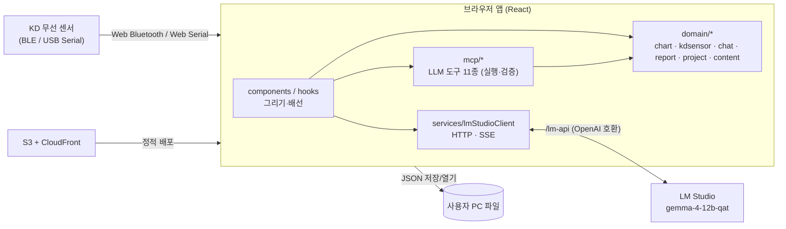

# 로컬 AI (Science# Local AI)

- **한 줄 요약**: 학생이 KD 무선 센서로 과학 실험 데이터를 측정하고, 차트로 보고 분석한 뒤, **로컬 LLM(LM Studio + Gemma 4)** 과 대화하며 보고서까지 쓰는 **서버 없는 브라우저 단독 실행형 웹앱**. LLM은 브라우저 안의 도구 계층(MCP 도구 11종)을 통해서만 차트·보고서를 다룬다. 이 프로젝트에서 나는 **AI·MCP 파트**를 맡았다. LLM 연동, 채팅·도구 파이프라인, MCP 도구, 그리고 이와 맞물린 차트 분석·보고서·수업 자료 화면이 내 담당이다. 센서 기반 코드는 팀장님 담당이다.

---

## 프로젝트 개요

| 항목 | 내용 |
|------|------|
| 제품 | Science#(사이언스샵) 로컬 AI — 과학 실험 센서 차트 + AI 학습 도우미 웹앱 (저장소 README 제목: "webappAI — 과학 실험 센서 차트 + AI 학습 도우미") |
| 목적 | 외부 클라우드 LLM 없이, 교실·사내망의 로컬 LLM으로 **측정 → 차트 → 분석 → AI 대화 → 보고서** 흐름을 브라우저 안에서 끝내기 |
| 사용자 | 초·중등 학생(학습자) 및 교사. 수업 자료(학생용 실험 안내, 교사용 AI 참조자료)와 연동 |
| 기간 | 2026-07-21 ~ 2026-09-07 (본인 커밋 기준, 약 7주) |
| 내 커밋 수 | **235건** (전체 브랜치, 머지 제외). 저장소 전체 비머지 커밋 246건 중 235건 |
| 역할 | **AI·MCP 담당**. 로컬 LLM 연동, 채팅 파이프라인(라우팅·프롬프트·도구 루프), MCP 도구 계층을 맡았고, 이와 맞물린 차트 분석·보고서·수업 자료 화면, 구조 리팩터링, 테스트, 문서화도 진행했다. **센서 기반 코드(BLE/Serial 통신, 센서 코어)는 팀장님 담당**이다 |
| 저장소 | `github.com/rapha155/science-sharp-local-ai` (원본: `github.com/araplatformkd/science-sharp-local-ai`, 브랜치 `main`, `chart-tab-redesign`) |

참고 사항
- 다른 기여자: `koreadigitalkbm` 커밋 11건(2026-08-10~13, 센서 통신 구조 변경·MCP 도구 간략화·chat 폴더 정리 등)은 본 문서의 성과에서 제외했다. 커밋 내용으로 보아 센서 코드를 맡은 팀장님 계정으로 추정되지만, 계정과 인물의 대응은 확인하지 않았다. 저장소 첫 커밋(`11c74d6`, Casey Chow)은 템플릿 이력으로 보인다.
- 첫 커밋 `ea79230`(2026-07-21)은 240개 파일, 약 3.4만 줄을 한 번에 들여온 **초기 코드베이스 반입**이다. 당시 구성은 React + Vite 프런트와 Express 서버(`src/server/llm`, Ollama/OpenAI 호환 클라이언트)였다. 데일리 노트상 2026-07 초부터 로컬 LLM 벤치마크와 MCP 설계를 진행했으므로 이전 작업이 포함된 것으로 보이나, **이 저장소 이전의 작업 범위는 커밋으로 확인할 수 없다.**
- 커밋 235건 중 163건에 `Co-authored-by: Cursor`, 39건에 `Claude-Session` 표기가 있다. **AI 코딩 도구(Cursor, Claude Code)를 활용해 개발**했다.
- 커밋 3건(`31e912c`, `5e0ae23`, `e7fdf88`)은 `git stash` 항목(index on / untracked files on)이다. 기능 커밋은 아니지만 집계에 포함했다.

---

## 배경과 문제 정의

### 왜 로컬 LLM인가
- **데이터를 외부 클라우드로 보내지 않기 위해**: 07-08 진행현황 노트에 검토 목적을 "인터넷 없이 로컬에서 실행 가능한 과학 실험용 AI 챗봇", "로컬 환경 기반 개인정보 보호"로 적었다. 저장소 문서(docs/09·10)도 "학교망·개인정보 제약이 있는 자리에서 아무 데도 데이터를 안 보내는 것이 요구 조건이 되는 경우가 있다"를 차별점으로 들고, 같은 이유로 클라우드 계정·동기화는 넣지 않기로 했다.
- **보유 장비로 돌릴 수 있는 크기**: RTX 5090(VRAM 32GB) 환경에서 Gemma 4 E2B·E4B·12B·26B·31B를 비교했다. 12B를 "E2B/E4B보다 과학 설명 품질이 좋고 26B/31B보다 속도 부담이 낮은" 1순위 후보로 정했다(07-08 노트). 앱은 `google/gemma-4-12b-qat`을 LM Studio에 올려 OpenAI 호환 API로 부른다(README: "로컬/사내망 LM Studio").

### 소형 로컬 모델의 제약 (커밋·문서에서 실제로 겪은 것)
- **도구 호출 형식이 깨진다**: `tool_calls` 대신 본문에 `<|tool_call>`·`[TOOL_REQUEST]` 마크업을 내보내고, 없는 도구 이름을 지어내거나 같은 호출을 반복한다(`2ea02a9`, `57ea8d3`, `5071da0`).
- **계산을 믿을 수 없다**: 지수 피팅을 LLM에게 직접 시켰을 때 모델은 R² 0.8545라고 답했지만, 그 계수를 원본 데이터에 다시 넣어 보니 R²는 −1.48이었다(08-12 노트, 비교 스크립트 `scripts/compare-exponential-llm.ts`, `ca0ef43`). "3τ = 52.4초" 같은 곱셈도 틀린다(docs/06).
- **규칙이 많을수록 지키지 못한다**: docs/05에 "로컬 소형 모델에게 문장 수는 곧 준수율"이라고 적었다. 그래서 쓰지 않는 규칙은 요청에 붙이지 않는다(`ccce243`).
- **서버 쪽 제약**: LM Studio는 객체형 `tool_choice`를 받지 않았고(`20e9d81`), JIT 로드 시 컨텍스트가 8192로 잡혀 응답이 잘렸다(`2ea02a9`, docs/05). 매 요청이 로컬 GPU에서 처음부터 계산되므로 프롬프트 재사용(프리픽스 KV 캐시)이 응답 속도에 직접 영향을 준다(`f7201e4`).

### 목표
1. LLM은 판단과 설명만 맡고, 데이터 조회·계산·차트 반영은 앱이 검증하는 도구 계층을 거치게 한다.
2. 소형 모델이 실수해도 측정 데이터와 화면이 망가지지 않게 한다(원본 보관, 허위 주장 검출, 망가진 호출 차단).
3. 별도 서버 없이 브라우저 하나와 LM Studio만으로 측정 → 분석 → 대화 → 보고서가 끝나게 한다.

### Before → After

| 구분 | Before | After | 근거 |
|---|---|---|---|
| 실행 구성 | 이전 프로토타입: Flutter 앱 + FastAPI 백엔드 + Python MCP 서버(`chart_mcp` 등) + Ollama (07-13 노트). 저장소 반입 시점에는 React + Express 서버(`src/server/llm`) | 서버 없는 브라우저 SPA가 LM Studio OpenAI 호환 API(`/lm-api` 프록시)를 직접 호출 | `ea79230`, `6112a60` |
| 도구 계층 | 백엔드가 MCP 서버를 프록시 호스트로 실행 | 브라우저 안 함수 11종(이후 `ask_direction` 추가)을 OpenAI function calling 스키마로 노출, 예외는 `{error, code}` 결과로 격리 | `671ddb4`, `b0a40a4`, `4708edf` |
| 분석 수치 | LLM이 직접 계산한 계수·R²를 그대로 표시할 수 있는 구조 | 표준 분석은 앱 Analyzer가 계산, 모델이 보낸 숫자는 버림 | `ca0ef43`, `4f8057f` |
| 도구 강제 | 객체형 `tool_choice`가 서버에서 거부돼 강제 호출이 동작하지 않음 | `required` + 범위를 좁힌 도구 목록, kind 정책 표 | `20e9d81`, `7e549fe` |
| AI 편집과 원본 | `write_series`가 원본 측정값까지 덮어씀, 편집 흔적 없음 | 첫 편집 직전 원본 보관(스키마 v6), 편집 표시, `restore_original_series` | `f8cc707`, `195cd54` |
| "변경했습니다" 답변 | 쓰기 도구가 돌지 않아도 완료라고 답할 수 있음 | `changeClaimGuard`가 탐지, 도구 루프 지표 기록 | `99588b7` |
| 토큰 여유 | 채팅 컨텍스트 32k, 채팅 출력 3k~6k (08-13 노트) | 컨텍스트 65,536, 채팅·차트 분석 출력 8192 | `86ace25`, `2ea02a9` |

---

## 기술 스택

| 구분 | 기술 |
|------|------|
| 프런트엔드 | React 19, React Router 7, TypeScript 7(`allowJs`, `strict: false`, JS 혼용), Vite 8 |
| 차트 | Recharts 3 (+ 자체 축 눈금·플롯 레이아웃 계산, 오버레이 레이어) |
| 스타일 | Sass(SCSS, `@use` 모듈), 디자인 토큰(CSS 변수), 라이트/다크 테마 |
| 아이콘·이미지 | @phosphor-icons/react, html-to-image(보고서용 차트 캡처) |
| LLM 런타임 | **LM Studio**의 OpenAI 호환 API(`/lm-api` 프록시), 모델 `google/gemma-4-12b-qat`, 컨텍스트 65,536 |
| LLM 연동 | 브라우저 직접 호출(`services/lmStudioClient`, HTTP + SSE 스트리밍), OpenAI function calling(`tool_calls`, `tool_choice`), Gemma 비표준 도구 마크업 파서 |
| 도구 계층 ("MCP") | 브라우저 안의 함수 11종(`src/mcp`). 별도 MCP 서버 없이 OpenAI function calling 스키마로 노출 |
| 수업 자료 검색 | `search_content` 도구, 헤딩 단위 문단 검색 + 한국어 조사 처리 (임베딩·벡터 DB는 사용하지 않음) |
| 센서 연동 (팀장님 담당) | Web Bluetooth(BLE GATT), Web Serial, KD 센서 프로토콜 스택(`domain/kdsensor`) |
| 저장 | 사용자 PC JSON 파일(프로젝트 스키마 v6), localStorage(설정·최근 본 자료·도구 루프 메트릭) |
| 테스트 | `tsx --test`(node:test) 도메인 단위 테스트, jsdom + Testing Library DOM 테스트, Playwright 시각 회귀 테스트 |
| 품질 | oxlint(`no-restricted-imports`로 계층 경계 강제), 차트 스타일 금지 규칙 검사 스크립트 |
| 배포 | AWS S3 + CloudFront(`deploy.ps1`, PowerShell + AWS CLI, 캐시 무효화), CloudFront `/lm-api` 프록시 |
| 초기 구성(이후 제거) | Express 5 서버, Ollama 클라이언트, react-markdown/remark-gfm → `6112a60`, `01c67e9`에서 제거 |

---

## 아키텍처 / 구조

서버 백엔드가 없다. 브라우저 앱이 센서와 직접 통신하고, LM Studio를 OpenAI 호환 API로 호출하며, 데이터는 메모리와 사용자가 저장한 JSON 파일에만 둔다.

핵심 설계 원칙 (README·docs에 명시, 본인 작성)
- **UI는 그리기만 한다.** 계산·판단은 React에 의존하지 않는 `src/domain/*`에 두고 `node --test`로 브라우저 없이 검증한다. 이 경계는 oxlint 규칙으로 강제한다.
- **LLM은 데이터를 직접 바꾸지 못한다.** LLM은 도구 호출을 *요청*만 하고, 실행·검증·반영은 앱(`src/mcp`)이 맡는다. 표준 분석 값은 앱 엔진이 계산하며, 모델이 보낸 숫자는 버린다.
- **원본 측정값 보존.** 첫 편집 직전에 원본을 한 부 보관하고, 편집 표시를 남기며, 언제든 원본으로 되돌릴 수 있다.

LLM 채팅 한 턴의 흐름
1. **라우팅**(`domain/chat/routing`): 사용자 문장을 정규식으로 분류(kind: `lesson_plain`/`analysis`/`series_edit`/`report`/`full` 등)하고, 열어 줄 도구와 `tool_choice`, 라운드 예산을 정한다.
2. **프롬프트 조립**(`domain/chat/prompting`): 고정 정책은 앞(system #0), 매 턴 바뀌는 차트 요약·실험 문맥은 뒤에 둔다. 프리픽스 KV 캐시를 재사용하기 위한 배치다.
3. **도구 루프**(`hooks/useChat`, `domain/chat/toolloop`): 스트리밍 응답에서 `tool_calls`(또는 Gemma 마크업)를 해석하고, 걸러서 실행한 뒤 결과를 다음 라운드에 붙인다. 루프 가드·변경 주장 검증·메트릭 기록을 거친다.
4. **도구 실행**(`mcp/execute.js`): 예외를 결과 객체로 바꿔 격리한 뒤 차트 store와 실험 스냅샷에 반영한다.

MCP 도구 11종: `get_experiments`, `read_series`, `write_series`, `undo_last_series_edit`, `restore_original_series`, `new_series`, `remove_analysis`, `read_report`, `write_report`, `set_condition_axis`, `search_content` (이후 `ask_direction` 추가, `4708edf`)

---

## 주요 기능

> 아래 화면은 `chart-tab-redesign` 브랜치(`33d2b87`)를 로컬 개발 서버로 띄워 1440×900으로 캡처했다. 차트 데이터는 실측값이 아니라 저장소의 시각 회귀용 **합성 픽스처**(`tests/visual/fixtures.mjs`)를 DEV 전용 주입 후크(`window.__chartDebug.loadProject`, `93bf423`)로 넣은 것이다. 캡처 시점에 LM Studio에 접속할 수 없어 실제 모델 응답 화면은 없다.

### 채팅 첫 화면

- 왼쪽은 AI 채팅, 오른쪽은 실험 차트·보고서·콘텐츠 탭이다. 입력창에서 `/`로 질문 예시를 열고, 브라우저 음성 인식으로 말로 물을 수 있다(`01e6352`).
- 아래 추천 카드는 MCP 도구 갈래(설명·분석 해석·보고서 등)에 맞춰 나온다. 차트에 분석 결과가 있으면 "분석 결과가 무엇을 뜻하는지" 카드가 붙는다.

### AI에게 차트 작업 요청 (도구 호출)

- **응답은 시연용 스텁**이다. LM Studio가 없어 Playwright에서 `/lm-api` 응답을 가로채, 모델 대신 `new_series` 도구 호출 1회와 짧은 마무리 문장을 돌려주게 했다. 답변 문장은 스텁이 만든 것이다.
- 그 밖의 처리는 실제 앱 코드다. 앱은 이 요청을 분석 요청으로 분류해 도구를 `new_series` 하나로 좁히고 `tool_choice: required`로 보냈다. 다음 라운드에서는 `auto`로 풀었다(`7e549fe`, 캡처 중 요청 본문으로 확인). 최고·최저 값(29.25 ℃ @ 59.8 s, 21 ℃ @ 0 s)은 앱 Analyzer가 계산했고, 범례에 **AI** 배지가 붙어 AI가 추가한 계열임을 드러낸다.

### 실험 차트 — 범례·구간 선택·분석 결과줄

- 범례는 계열을 켜고 끄는 계열 관리자다(`68a501b`). 단위가 다른 계열은 좌/우 축으로 나뉜다. 플롯을 드래그하면 위에 「13–25 s 선택됨」 상태줄과 통계·직선 맞춤·곡선 맞춤·면적·빼기·메모·**AI에게 묻기** 칩이 나온다(`346a697`, `93a20a4`).
- 플롯 아래 결과줄에 분석 식과 R²가 남는다(`e2d34ff`). 학습자 메모는 플롯 위 띠로 표시된다.

### 분석 시트

- AI 없이도 직접 분석할 수 있다. 대상 → 구간 → 방법 순서로 고르고, 고급 분석은 체크해야 보인다(`93a20a4`). 계산은 AI 경로와 같은 앱 분석 엔진이 한다.

### 보고서

- 보고서는 실험 개요 → 과정 → 조건 → 관찰 데이터 → 그래프 해석 → 결론 → 더 탐구해 볼 점의 7섹션이다(`domain/report/sections.ts`). "측정한 값을 근거로 AI가 초안을 잡고, 고쳐 쓰는 사람은 학습자"라는 문구대로 초안 요청 후 섹션별 직접 작성·검토를 할 수 있다(`2a5d990`). 파일 다운로드·인쇄를 지원한다(`82c2ad6`, `610e3a8`).
- 캡처에는 모델이 없어 초안을 만들지 못한 **빈 상태 화면**만 담았다.

### 수업 자료(콘텐츠)

- SCPX 실험 꾸러미에서 가져온 자료를 학교급·학년 순으로 묶어 보여 준다(`2ec9bfe`, `3c9355b`, `05df524`). 목록은 개발 서버 프록시로 배포된 자료 라이브러리를 읽었다.
- 자료를 읽다가 「이어서 물어보기」로 채팅에 넘길 수 있고, 채팅에서는 LLM이 `search_content`로 근거 문단을 찾는다.

### 다크 테마

- 디자인 토큰(CSS 변수)으로 라이트/다크를 전환한다. 다크 배경을 중립 검정으로 바꾸고 강조색·카드 면 토큰을 정리했다(`de55b84`, `389c14e`).

---

## 내가 한 일

### 1. LLM 채팅 파이프라인 · 로컬 모델 연동
- Express 서버를 없애고 **브라우저가 LM Studio를 직접 호출**하도록 전환했다. Vite·CloudFront에 `/lm-api` 프록시를 추가했다 (`6112a60`, 08-07).
- 서버 LLM 모듈을 core/prompts/reports/tools/test로 재구성하고, 쓰지 않는 분석·차트 API를 제거했다 (`caf266e`, 08-05).
- 과학·실험 답변 정책 `SCIENCE_STANCE`를 추가했다. 측정량·단위를 쓰고 관찰과 해석을 나누도록 유도하며, 과학과 무관한 질문에는 과학 틀을 씌우지 않는다 (`a0a23e7`, 08-10).
- 의도별로 지연과 도구 경로를 최적화했다 (`e3f806f`, 08-11). 요청마다 넘기는 도구와 컨텍스트를 줄이고, 유형별 라운드·이어쓰기 예산과 구조화 계측을 적용했다(P1~P5) (`b1b86e5`, 08-14).
- LLM 호출을 안정화하고 **프리픽스 캐시를 고려해 메시지 배치를 최적화**했다. `domain/chat`을 routing/prompting/toolloop/response로 재구성했다 (`f7201e4`, 08-20).
- 채팅 kind 정책을 한 표(`chatKindPolicy.ts`)로 통합했다. kind별 도구·`tool_choice`·라운드 예산을 한 곳에서 관리한다 (`7e549fe`, 08-21).
- 차트 요약 투영을 도입하고, 다중 계열 규칙은 센서가 2개 이상일 때만 요청 컨텍스트에 붙인다 (`e6a1833`, `ccce243`, 08-24).
- LM Studio 컨텍스트를 65,536으로 맞추는 스크립트를 넣었다. 출력 한도 잘림(`finish=length`)·빈 응답은 max_tokens 조정, 컨텍스트 클램프, 이어쓰기로 완화했다 (`2ea02a9`, `86ace25`, 08-13~14).

### 2. MCP 도구 계층 (LLM이 앱을 다루는 유일한 통로)
- 초기에 MCP 계측 레이어를 구축하고 TypeScript로 전환했다 (`9fc865b`, 07-21). 센서 차트 데이터는 자동으로 분할 조회하고 버전 충돌을 막았다 (`a8258ae`, 07-23).
- 도구 정의를 shared 카탈로그로 단일화했다 (`671ddb4`, 07-27). 차트 도구는 조회/분석/편집으로 나눴다 (`0c7393a`, 08-05).
- 도구 모듈을 series/analysis/report/collection/content로 재구성하고 **실행 오류를 격리**했다. 예외가 나면 그 라운드 전체를 실패시키지 않고 `{error, code}` 결과로 돌려준다 (`b0a40a4`, 08-20).
- `write_series` 편집 엔진을 만들었다. 구간 삭제·반전·배율·오프셋을 앱 엔진이 계산하고, LLM이 점을 다시 쓰던 경로는 없앴다 (`4f8057f`, 08-18).
- 시리즈 편집 되돌리기와 원본 보존을 추가했다 (`f8cc707`, 08-19). 편집 데이터를 공개하고 측정 원본을 보관한다(`restore_original_series`, 스키마 v6) (`195cd54`, 08-20). 열린 구간 삭제 계약도 지원한다 (`0098042`, 08-21).
- 대상 계열 판단을 통합했다(`seriesTarget.js`) (`a829f93`, 08-24). 계열이 모호하면 임의로 고르지 않고 되묻는다 (`f6d5b65`, 08-24).
- 튄 값을 지우지 않고 분석에서 빼는 `exclude_range`를 구현했다 (`bbfe6fd`, 08-25). 조건축 설정 도구 `set_condition_axis`를 추가했다 (`5dfc0f9`, 08-25).
- 답변 방향을 학습자가 고르게 하는 `ask_direction` 도구와 선택 카드(ChoiceCards)를 추가했다. 라벨 문구가 편집 라우팅으로 새지 않는지 앱이 검사한다 (`4708edf`, 08-31).

### 3. 도구 루프 안정성 · 신뢰성 가드
- `read_series` 중복 호출로 빈 응답이 이어지던 Gemma 도구 루프를 끊었다 (`57ea8d3`, 08-13).
- Gemma/LM Studio가 `content`에 넣는 비표준 도구 마크업(`<|tool_call>`, `[TOOL_REQUEST]`)을 파싱해 복구한다 (`2ea02a9`, 08-14).
- `tool_choice` 강제 방식을 `required` + 단일 도구로 바꿨다 (`20e9d81`, 08-20).
- 망가진 도구 호출을 걸러 내는 필터(라운드당 3개 상한, 허용 외 이름·파싱 불가 인자 제거)와 턴 안전장치를 만들었다 (`5071da0`, 08-21).
- 변경 주장 검증(`changeClaimGuard`)을 추가했다. 쓰기 도구가 하나도 돌지 않았는데 "변경했습니다"라고 하는 답변을 잡는다. 도구 루프 관측 지표(링 버퍼)도 함께 넣었다 (`99588b7`, 08-24). 개발용 콘솔 판독 도구는 `65bb1d9`(09-02)에서 추가했다.
- 답변에 남는 도구 호출·결과 마커(`[TOOL_RESULT]` raw JSON)를 지우고 답변 가드를 걸었다 (`f7587be`, 08-28).

### 4. 차트 · 분석 엔진
- 분석 엔진을 12종 알고리즘으로 재구성했다. PEAKS·VALLEYS·OUTLIERS는 다중 계열을 지원하고, 최저점 분석을 추가했으며, 마커 라벨 모드를 동적으로 바꾼다 (`6f483b3`, 07-28).
- **물리량(Quantity) 표준화와 실험 템플릿**으로 차트 종류·분석 방법을 코드가 정하게 했다. 산점도, 미분/적분/FFT 분석, `recommend_chart` 도구를 연결했다 (`97f84f2`, 08-03).
- 최대 변화 구간 하이라이트 명령(`1ee8c5e`), domain/chart 재배치와 Analyzer 핵심·고급 분리(`45477dc`), 지수분석 결과 신뢰성 개선(`ca0ef43`), 분석 출처 추적·관계 분석(`b5a6e3c`)을 진행했다.
- 파생 계열 색을 원본 센서에서 유도하고(`b0b7393`), 시리즈 색상 슬롯(`cf9cd65`, `160447d`)을 도입했다. X축 시간 정밀도(`08b7337`)와 변환 계열 범례·Y축 스케일(`50b57b4`)을 바로잡았다.
- **조건축 수동 수집 모드의 차트·AI 측면**을 구현했다. 시간 대신 조건(예: 추 개수)을 X축으로 쓰는 측정이다. 조건축 도메인, 막대 차트·예측 시리즈, 차트 브리지, LLM 도구 `set_condition_axis`를 만들었다 (`5dfc0f9` 08-25, 08-27 작은 단위 커밋 72건: `ba5a9d9`, `bc423e6`, `ca247f0`, `6032e71` 등). 센서 쪽 수집 기능(`KDSensorManage.manualCollect` 등)은 기존 코드를 연결해 썼다(docs/12: "레일은 이미 절반 깔려 있다").
- 차트 축 눈금·폭 계산과 캔버스 연동 (`bc6207a`, 08-28).

### 5. 차트 탭 전면 개편 (`chart-tab-redesign` 브랜치, 09-02~09-07)
- 개편 계획 문서를 작성했다. 현황 감사 50항목, 레퍼런스 14곳, P0~P5 로드맵이 들어 있다 (`e788e02`).
- 시각 회귀·DOM 테스트 기반을 마련했다. Playwright 기준 이미지 12장(픽스처 3 × 테마 2 × 뷰포트 2), jsdom + Testing Library `test:dom`, DEV 전용 합성 데이터 주입 후크를 넣었다 (`93bf423`).
- 화면 변화 없이 리팩터링했다(시각 회귀 12장 diff 0). 상호작용 상태 리듀서, 도메인 분리, 화면 문자열 157개 i18n, `ChartPanel` 855→402줄, `LineChartView` 807→362줄 (`6d0a8d1`).
- 도구줄을 플롯 밖으로 옮기고(`7a157d4`) 상태줄·상태 칩을 추가했다(`346a697`). 범례를 계열 관리자로 바꾸고(`68a501b`), 툴팁 대신 크로스헤어·읽기 줄을 넣었으며(`5d9f8a8`), 플롯 아래 분석 결과줄을 만들었다(`e2d34ff`).
- P2-7~P3-5를 진행했다. 드래그 기본값을 구간 선택으로 바꾸고 키보드 조작(S·←→·Enter·Esc·Ctrl+A)을 넣었다. 표 가상 스크롤, 분석 시트(대상→구간→방법), 스타일 금지 규칙 lint, 기준 이미지 16장 갱신도 포함된다 (`93a20a4`).
- 표와 차트를 잇는 선택 (`33d2b87`, 09-07).

### 6. 보고서
- LLM 보고서 생성 및 버전 관리 (`ea79230`, 07-21). 다중 버전 탭, 핵심 섹션 품질 평가 (`6f483b3`).
- 보고서 보강 저장, 섹션별 보강 액션, 상태 요약 (`771b6cd`, `5acd12a`, 08-04). 검토 UI와 섹션 직접 작성 (`2a5d990`, 08-24).
- 보고서 차트 캡처 시점 갱신(`9188153`). 파일 다운로드·인쇄·용지 스타일(`82c2ad6`, `165f682`, `610e3a8`).

### 7. 수업 자료(콘텐츠) · 학습 흐름
- 수업 자료 중심 학습 흐름과 채팅 구조를 정리했다 (`63e22f8`, 07-24). 사이드바는 콘텐츠 브라우저 패널로 바꿨다 (`3370871`).
- **SCPX 실험 콘텐츠 라이브러리 연동**: S3의 `.scpx` 실험 꾸러미를 풀어 학생용 안내와 교사용 AI 참조자료로 옮기는 가져오기 스크립트를 만들었다 (`2ec9bfe`, 08-25). 학교급·학년 정렬과 구분줄(`3c9355b`, `05df524`), 마크다운 이미지 렌더링(`ebe272b`), CloudFront 무효화(`0cbd594`)도 진행했다.
- 콘텐츠 탭을 감사(docs/14)하고 개선했다(09-01~02). 목록 뭉침·제목 반복 교정(`b36b4ea`), 읽기 폭 통일(`7a54dbc`), 「이어서 물어보기」를 학습자 말투로 바꿈(`f1fb8a4`), 최근 본 자료(`df34b6c`), 「다음 자료」(`71e09a6`), 한글 표 칸 접힘 수정(`b30f098`) 등.

### 8. 채팅 UI · 디자인 시스템 · 접근성
- 채팅 첫 화면과 입력창을 구성했다. `/` 질문 예시, 브라우저 음성 인식 마이크, MCP 도구 갈래에 맞춘 추천 카드 4장이 들어간다 (`01e6352`, 08-31).
- 디자인 토큰을 정리했다. 다크 배경을 중립 검정으로 바꾸고 강조색과 카드 면 토큰을 손봤으며, 차트 SCSS 13개를 옮기고 i18n 테스트가 누락돼 있던 것을 바로잡았다 (`de55b84`, 08-31). 손으로 적은 스타일 값은 토큰으로 이관했다 (`389c14e`, 09-02).
- 다이얼로그 포커스 함정 유틸·훅을 만들어 확인·편집 다이얼로그 5곳에 적용했다 (`1f5d832`, `9655c53`, `84239aa`~`0c3af80`, 08-27).
- 한국어 전용 서비스에 맞춰 영어·일본어 다국어 구조를 걷어 냈다 (`6b653d7`, 07-27). 이후 차트 탭 문자열은 ko/en i18n으로 다시 정리했다 (`6d0a8d1`).

### 9. 구조 리팩터링 · 빌드 · 문서
- 07-27 하루 동안 기능별 폴더(features/content·project·sensor·report·chart·chat) 재편을 연속 커밋으로 진행했다. 순환 참조를 없애고 **계층 경계를 lint로 강제**했다 (`db45b95`~`63cfbf5`). CSS→SCSS, `@import`→`@use` 전환도 같은 날 했다 (`c2fdcb8`, `08636f9`).
- 이후 components/hooks/domain/mcp 구조로 다시 통합했다 (`6112a60`). chat·project·content 도메인 정리 (`4e966c1`, `b231a1e`, `38c69d5`).
- 죽은 코드·미사용 의존성·디버그 엔드포인트·admin 화면을 제거했다 (`5d60997`, `3dd23e7`, `76dbe98`, `01c67e9`).
- 문서화: README, 아키텍처/UI/차트/센서/LLM 파이프라인/MCP/데이터/빌드 문서(docs/01~14), MCP 도구 호출 플로우, LLM 실행 계층 문서 (`516aca4`, `ab9a20e`, `76dfacc`, `1ceb5ec`, `8b41cf5`, `64a2210`, `866c814`).

### 10. (참고) 센서 코드에 닿은 커밋 — 주 담당 아님
센서 기반 코드는 팀장님 담당이다. 아래 커밋은 내 이름으로 남아 있지만 AI·차트 기능을 붙이거나 화면과 연결하는 과정에서 생긴 **보조 수정**이므로 핵심 성과로 내세우지 않는다. 대부분 Cursor 공동 작성 표기가 있다.
- `domain/kdsensor` 코어를 수정한 커밋: 이중 센서 측정 끊김(BLE 쓰기 직렬화) `2ffa50f`(08-06), BLE·시리얼 연결 안정화 `6b9bdc2`(08-11), 끊긴 센서 빈 계열 제외 `9e76789`, 재연결 시 데이터 유지 `634213b`(08-28).
- 수동 수집 기능을 위한 소규모 연결 코드: `2a64d29`(+11줄), `288ce87`(+10줄), `dee5ee7`, `f30d689`(측정 안정도 판정).
- `8c971fa`(08-10, "rx 동기화 구조 변경")는 같은 날 `koreadigitalkbm`의 동일 제목 커밋(`10f0df2`)과 제목이 같다. 팀장님 변경을 반영한 커밋으로 보인다.

---

## 기술적 문제 해결 사례

### 1. 로컬 서버가 `tool_choice` 함수 지정 형식을 거부함 (`20e9d81`, `7e549fe`, 2026-08-20~21)
- **문제**: 편집·되돌리기처럼 특정 도구를 강제해야 하는 요청이 실패했다.
- **원인**: LM Studio가 OpenAI의 객체형 `tool_choice`(`{type:'function', ...}`)를 받지 않았다(`Invalid tool_choice type: 'object'. Supported: none, auto, required`). 커밋 메시지에는 이 오류 때문에 "강제 호출이 지금까지 한 번도 성공하지 못했을 가능성이 크다"고 적었다.
- **해결**: 도구 목록을 좁히고 `tool_choice: 'required'`로 보내는 방식으로 바꿨다. 이후 잘라 낸 목록이 루프 내내 남아 "지우고 최고점도 표시해 줘" 같은 복합 요청의 뒷부분이 사라지는 문제가 드러났다(docs/05 기록). 그래서 강제는 0라운드에서만 걸고, 열어 주는 도구는 그 요청이 실제로 바꿔야 하는 범위까지만 넓히도록 kind 정책 표로 정리했다.
- **결과**: 강제 경로가 실제로 동작하게 됐다. 정책은 `Record<kind, …>` 타입으로 묶어, kind를 추가하면 정책을 모두 채울 때까지 컴파일이 막힌다.

### 2. 소형 로컬 모델(Gemma)의 도구 루프 붕괴 (`57ea8d3`, `2ea02a9`, `5071da0`, `f7587be`)
- **문제**: 같은 `read_series`를 반복 호출하면서 빈 응답이 이어졌다. 도구 호출이 `tool_calls`가 아니라 본문 텍스트(`<|tool_call>`, `[TOOL_REQUEST]`)로 나오기도 했다. 관측된 한 턴에서는 없는 도구 이름을 지어내고, 인자를 조금씩 망가뜨린 같은 편집을 10번 내보냈으며, 마지막 인자가 14,000자에 달했다(`toolCallFilter.ts` 주석 기록). 화면에 `[TOOL_RESULT]` raw JSON이 그대로 나오기도 했다.
- **원인**: 소형 로컬 모델은 확신이 없을 때 도구 호출 형식과 인자를 망가뜨린다. 앱은 이를 그대로 실행하거나 표시하고 있었다.
- **해결**: 같은 시리즈 재조회는 캐시와 텍스트 답변 강제로 끊었다. Gemma 마크업 파서로 비표준 호출을 복구했다. 라운드당 실행 상한 3개, 허용 외 도구·파싱 불가 인자 제거 필터를 넣었고, 걸러 낸 호출은 콘솔에 남긴다. 표시용 정리 단계에서 도구 결과 마커를 지웠다.
- **결과**: 쓰기 도구가 무더기로 실행되거나, 실패 결과가 다음 프롬프트에 쌓여 요청이 부풀어 오르는 경로를 막았다. 관련 단위 테스트(`gemmaToolCalls.test.ts`, `toolCallFilter.test.ts` 등)를 함께 추가했다.

### 3. LLM의 "변경했습니다" 허위 답변 (`99588b7`, 2026-08-24)
- **문제**: 학습자가 "전부 2배로"라고 하자 모델이 도구를 한 번도 부르지 않고 "모든 값을 2배로 변경했습니다"라고 답했다. 차트는 바뀌지 않았다.
- **원인**: 명령형 어미가 없어 편집 요청으로 분류되지 않았고(kind `full`, `auto`), 앱은 *도구가 무엇을 했는가*만 검증할 뿐 *답변의 주장*은 검증하지 않았다. 강제 범위를 넓히면 "2배"가 들어간 개념 질문까지 편집으로 걸려 측정값이 지워질 위험이 있었다.
- **해결**: 라우팅은 그대로 두고, 쓰기 도구가 실제로 돌지 않았는데 완료형으로 "바꿨다"고 주장하는 답변을 뒤에서 잡는 `changeClaimGuard`를 추가했다. 도구 루프 메트릭을 localStorage 링 버퍼에 기록하게 했다.
- **결과**: 오분류의 피해를 늘리지 않고 허위 변경 주장을 탐지한다. 테스트 101줄을 추가했다.

### 4. AI 편집이 원본 측정값을 덮어쓰던 데이터 무결성 문제 (`f8cc707`, `195cd54`, 2026-08-19~20)
- **문제**: `write_series`가 차트뿐 아니라 원본 측정값(`sensorData`)까지 덮어썼다. 실험 스냅샷은 제자리 교체 방식이라 이력이 없었고, 나중에 차트를 봐도 원본인지 편집본인지 알 수 없었다. 한 턴에서 같은 측정의 두 계열을 연달아 편집하면 앞선 편집이 사라졌다.
- **원인**: 원본 보관 장치가 없었다. 도구 컨텍스트의 `getProject`는 렌더 시점 상태를 붙잡고 있었다.
- **해결**: 첫 편집 직전에 `experiment.rawSensorData`로 원본 한 부를 보관하게 했다(프로젝트 스키마 v6). 이 기능 이전에 편집된 실험은 `rawSensorDataUnavailable`로 표시한다. `metadata.lastEdit`·범례 표식·보고서에 편집 사실을 공개하고, `restore_original_series`를 추가했다. 되돌리기 보관량은 10건/20,000점에서 2건/5,000점으로 줄였다. 도구 컨텍스트는 `getLatestProject(projectRef)`로 바꿨다.
- **결과**: "데이터 정비는 숨기면 조작, 밝히면 정당한 절차"라는 원칙을 코드로 구현했다. 큰 계열은 이력 대신 보관본만 남아 저장량도 줄었다.

### 5. 화면을 바꾸지 않고 차트 탭 대형 컴포넌트 분해 (`93bf423`, `6d0a8d1`, 2026-09-02)
- **문제**: `ChartPanel`(855줄), `LineChartView`(807줄), `ChartWorkArea`(580줄)에 상태·계산·렌더가 섞여 있었다. 개편 전에 구조를 정리해야 했지만 화면이 바뀌면 안 됐다.
- **해결**: 먼저 Playwright 시각 회귀 기준 이미지 12장과 jsdom DOM 테스트 환경, 합성 데이터 주입 후크를 만들었다. 그다음 도구·선택·핀·뷰포트·호버 상태를 리듀서 하나로 모으고, 가시성·노트 변경·플롯 모델을 도메인으로 뽑았다. rAF 코얼레싱과 memo도 적용했다.
- **결과**: 시각 회귀 12장의 diff가 0인 상태로 `ChartPanel` 855→402줄, `ChartWorkArea` 580→362줄, `LineChartView` 807→362줄이 됐다. 이어진 UI 개편(P2~P3)은 같은 기준 이미지를 16장으로 갱신해 검증했다(허용 오차 0.1%).

---

## 타임라인

| 기간 | 주요 작업 | 대표 커밋 |
|------|-----------|-----------|
| 07-21 ~ 07-24 | 초기 코드베이스 반입, LLM 보고서·버전 관리, MCP 계측 레이어·TS 전환, 센서 차트 MCP 분할 조회, 수업 자료 중심 학습 흐름 | `ea79230`, `9fc865b`, `a8258ae`, `63e22f8` |
| 07-27 ~ 07-28 | 기능별 폴더 재편·계층 경계 lint, SCSS 전환, 한국어 전용화, 분석 엔진 12종 재구성 | `671ddb4`, `63cfbf5`, `c2fdcb8`, `6f483b3` |
| 08-03 ~ 08-07 | 물리량 기반 차트/분석 추천·산점도·FFT, recommend_chart 도구, 보고서 보강, 구조 정리, Express 제거·LM Studio 직접 연동 | `97f84f2`, `771b6cd`, `caf266e`, `6112a60` |
| 08-10 ~ 08-14 | domain/chart 재배치, SCIENCE_STANCE, 의도별 지연 최적화, 도구 루프 안정화, Agent 경로 최소 개입 | `45477dc`, `a0a23e7`, `e3f806f`, `57ea8d3`, `b1b86e5` |
| 08-18 ~ 08-21 | write_series 엔진, 되돌리기·원본 보존, MCP 오류 격리, 프리픽스 캐시, tool_choice 수정, 도구 호출 방어, README·문서 | `4f8057f`, `195cd54`, `b0a40a4`, `f7201e4`, `20e9d81`, `5071da0` |
| 08-24 ~ 08-28 | 계열 대상 판단·되묻기, 변경 주장 검증, 보고서 검토 UI, SCPX 콘텐츠 연동, 조건축·막대 차트·set_condition_axis, 포커스 함정, 보고서 인쇄 | `a829f93`, `99588b7`, `2ec9bfe`, `5dfc0f9`, `610e3a8`, `f7587be` |
| 08-31 ~ 09-02 | 채팅 첫 화면·음성 입력, ask_direction, 디자인 토큰, 콘텐츠 탭 감사·개선 | `01e6352`, `4708edf`, `de55b84`, `df34b6c` |
| 09-02 ~ 09-07 | 차트 탭 전면 개편(`chart-tab-redesign`): 계획, 시각 회귀 테스트, 무변경 리팩터, 상태줄·크로스헤어·결과줄·구간 선택, 표-차트 연결 | `e788e02`, `93bf423`, `6d0a8d1`, `93a20a4`, `33d2b87` |

월별 커밋 수: 7월 22건 / 8월 177건 / 9월 36건

---

## 포트폴리오용 핵심 성과 문장

- 서버 없이 브라우저에서 동작하는 과학 실험 학습 웹앱(React 19 · Vite · TypeScript)에서 **AI·MCP 파트를 담당**했다. 7주간 커밋 235건으로 **차트 분석 → 로컬 LLM 대화 → 보고서**의 AI 흐름을 구현했다(센서 통신은 팀장님 담당).
- Express 백엔드를 없애고 브라우저가 **LM Studio(Gemma 4 12B QAT)의 OpenAI 호환 API**를 직접 호출하도록 전환했다. SSE 스트리밍과 function calling 기반 도구 루프를 구현했다.
- LLM이 데이터를 직접 바꾸지 못하게 하는 **브라우저 내 MCP 도구 계층(11종)** 을 설계했다. 표준 분석은 앱 엔진이 계산하고, 도구 예외는 결과로 바꿔 격리했다.
- 소형 로컬 모델의 도구 호출 붕괴에 대응했다. 비표준 마크업 파싱, 망가진 호출 필터, 중복 조회 차단, **허위 "변경 완료" 답변 검증 가드**, 도구 루프 메트릭으로 응답 신뢰성을 높였다.
- 요청 의도별 라우팅(kind 정책 표)으로 노출 도구와 `tool_choice`·라운드 예산을 좁히고, **프리픽스 KV 캐시를 살리는 메시지 배치**로 로컬 추론 비용을 줄였다.
- AI 편집 시 **원본 측정값을 보관하고 편집 사실을 공개**하는 구조(스키마 v6, 원본 복원 도구)를 도입해 과학 데이터 무결성을 지켰다.
- 수업 자료(SCPX 실험 꾸러미)를 웹앱 라이브러리로 가져오는 파이프라인과, LLM이 근거 문단을 찾는 `search_content` 도구를 연결해 **수업 자료에 근거한 학습 채팅**을 구성했다.
- Playwright 시각 회귀(기준 12장, diff 0)를 안전망으로 차트 탭 대형 컴포넌트를 절반 이하로 분해했다(855→402줄 등). 이후 차트 탭 UI 전면 개편을 진행했다.

---

## 성과 지표 요약

| 지표 | 값 | 근거 커밋 |
|---|---|---|
| 본인 커밋 | 235건 / 저장소 전체 비머지 246건, 약 7주(07-21~09-07) | 부록 목록 |
| LLM 도구(MCP) 수 | 브라우저 내 도구 11종 → `ask_direction` 추가로 12종 (`src/mcp/catalog.js` 기준) | `b0a40a4`, `4708edf` |
| 도구 강제 호출 | 서버가 객체형 `tool_choice`를 거부해 동작하지 않던 강제 경로를 `required` 방식으로 복구 | `20e9d81` |
| 망가진 도구 호출 차단 | 라운드당 실행 상한 3개, 허용 외 이름·파싱 불가 인자 제거 (관측 사례: 같은 편집 10회 반복, 인자 14,000자) | `5071da0` |
| 지수 피팅 신뢰성 | LLM 직접 피팅: 주장 R² 0.8545 → 검산 시 −1.48. 이후 계수·R²는 앱 Analyzer가 계산 | `ca0ef43` |
| 되돌리기 보관량 | 10건/20,000점 → 2건/5,000점 (원본은 별도 1부 보관) | `195cd54` |
| LLM 토큰 여유 | 채팅 컨텍스트 32k → 65,536, 채팅 출력 3k~6k → 8192 | `86ace25`, `2ea02a9` |
| 차트 탭 컴포넌트 분해 | `ChartPanel` 855→402줄, `ChartWorkArea` 580→362줄, `LineChartView` 807→362줄, 시각 회귀 12장 diff 0 | `6d0a8d1` |
| 화면 문자열 i18n | 차트 탭 문자열 157개 | `6d0a8d1` |
| 시각 회귀 기준 이미지 | 12장(픽스처 3 × 테마 2 × 뷰포트 2) → 16장, 허용 오차 0.1% | `93bf423`, `93a20a4` |
| 테스트 파일 (브랜치 최신 기준) | `src/mcp` 19개, `src/domain/chat` 31개 (`src` 전체 198개, 팀장님 작성분 포함 가능) | `33d2b87` 시점 집계 |

> 응답 지연·캐시 적중률 같은 수치는 커밋·문서에 측정값이 남아 있지 않아 넣지 않았다. 도구 루프 메트릭(`99588b7`, `65bb1d9`)으로 측정할 수 있으니, 수치가 필요하면 LM Studio 환경에서 다시 재야 한다.

## 배운 점 · 회고 (초안 — 본인 확인 후 수정)

- **소형 모델은 판단에만 쓰고, 계산은 앱이 맡는다.** 지수 피팅을 LLM에게 맡겼더니 그럴듯한 R²를 내놓았지만 검산해 보니 맞지 않았다(`ca0ef43`). 그 뒤로는 "LLM은 요청만, 실행·검증은 앱"을 설계 원칙으로 문서에 적고(README) 표준 분석의 숫자는 버리게 했다.
- **모델을 고치기보다 모델의 실패를 견디는 코드를 짠다.** 비표준 마크업 파서, 망가진 호출 필터, 중복 조회 차단, 변경 주장 검증(`2ea02a9`, `5071da0`, `57ea8d3`, `99588b7`)은 모두 모델이 틀릴 것을 전제로 둔 장치다. 라우팅을 넓혀 오분류를 줄이는 대신 뒤에서 허위 주장을 잡는 쪽을 택한 것도 같은 이유다.
- **과학 데이터는 고친 사실을 숨기지 않는다.** AI 편집이 원본을 덮어쓰던 구조를 "숨기면 조작, 밝히면 정당한 절차"라는 기준으로 바꿨다(`195cd54`). 되돌리기 이력보다 원본 한 부가 더 확실하고 저장량도 적었다.
- **로컬 추론에서는 프롬프트 배치가 곧 성능이다.** 매 턴 바뀌는 값을 앞에 두면 프리픽스 캐시가 매번 깨진다. 고정 정책은 앞, 변하는 컨텍스트는 뒤에 두고, 쓰지 않는 규칙은 빼는 쪽이 준수율에도 낫다는 것을 문서로 남겼다(`f7201e4`, docs/05).
- **큰 리팩터링은 안전망부터 만든다.** 시각 회귀 기준 이미지와 합성 데이터 주입 후크를 먼저 만든 덕분에, 화면을 한 픽셀도 바꾸지 않고 대형 컴포넌트를 절반 이하로 줄였다(`93bf423`, `6d0a8d1`). 이번 포트폴리오 캡처도 같은 후크로 찍었다.

## 면접 예상 질문

1. **도구 계층을 별도 MCP 서버가 아니라 브라우저 안에 둔 이유는?**
   - 7월 프로토타입은 FastAPI가 Python MCP 서버를 프록시 호스트로 돌리는 구조였다(07-13 노트). 이 앱은 서버 없는 SPA라, 도구가 바꿀 대상(차트 store, 실험 스냅샷)이 브라우저 메모리에 있다. 서버를 두면 상태를 왕복 동기화해야 한다.
   - 그래서 OpenAI function calling 스키마로 브라우저 안 함수를 노출했다(docs/06: "이름은 MCP지만 별도 서버는 없다"). Express 서버를 없애고 LM Studio를 직접 호출하도록 바꿨다(`6112a60`).
   - 대가: 표준 MCP 클라이언트(다른 LLM 앱)에서 재사용할 수 없다. 도구 정의를 `catalog.js` 한 곳에 모아 두었으니 필요하면 어댑터를 붙일 수 있다.
2. **소형 모델의 도구 호출 실패는 어떻게 다뤘나?**
   - 형식: 본문에 섞인 `<|tool_call>`·`[TOOL_REQUEST]`를 파싱해 복구하고 표시 텍스트에서 지움(`2ea02a9`, `f7587be`).
   - 내용: 라운드당 3개 상한, 허용 외 도구·파싱 불가 인자 제거, 걸러 낸 호출은 콘솔 기록(`5071da0`). 같은 `read_series` 반복은 캐시와 텍스트 답변 강제로 끊음(`57ea8d3`).
   - 결과 검증: 쓰기 도구가 안 돌았는데 "변경했다"고 하면 `changeClaimGuard`가 잡음(`99588b7`). 도구 예외는 `{error, code}`로 격리해 라운드 전체를 실패시키지 않음(`b0a40a4`).
3. **프리픽스 캐시를 어떻게 활용했나?**
   - 로컬 LLM은 프롬프트 앞부분이 같으면 KV 캐시를 재사용한다. 고정 정책·레슨 발췌는 system #0, 매 턴 바뀌는 차트 요약·선택 구간은 뒤쪽 system 메시지에 둔다(`f7201e4`, docs/05).
   - 라운드 사이에 `tools`가 같아야 캐시가 유지되므로 `tool_choice: none`일 때도 tools를 보낸다. 다중 계열 규칙처럼 조건부인 문장은 요청 컨텍스트 쪽에 붙인다(`ccce243`).
   - 효과 수치는 측정해 두지 않았다. 도구 루프 메트릭으로 재야 한다고 솔직히 말한다.
4. **AI가 측정 데이터를 바꿀 때 무결성은 어떻게 지켰나?**
   - LLM은 점을 직접 쓰지 않는다. `write_series`는 구간 삭제·반전·배율·오프셋 같은 연산만 받고 앱 엔진이 계산한다(`4f8057f`).
   - 첫 편집 직전 원본을 `rawSensorData`로 보관(스키마 v6), 편집 사실을 범례·보고서에 공개, `restore_original_series`로 복원. 이전 버전 파일은 `rawSensorDataUnavailable`로 표시해 편집본을 원본이라 부르지 않게 함(`195cd54`).
   - 튄 값은 지우지 않고 분석에서만 빼는 `exclude_range`(`bbfe6fd`).
5. **`tool_choice` 강제가 안 되던 문제는 어떻게 찾고 고쳤나?**
   - LM Studio가 객체형 `tool_choice`를 거부하는 오류(`Invalid tool_choice type: 'object'. Supported: none, auto, required`)를 확인했다. `required` + 좁힌 도구 목록으로 바꿨다(`20e9d81`).
   - 그 뒤 잘라 낸 목록이 루프 내내 남아 복합 요청의 뒷부분이 사라지는 문제가 생겼다. 강제는 0라운드에만 걸고, kind별 정책을 `Record<kind, …>` 표로 묶어 누락을 컴파일 단계에서 막았다(`7e549fe`).
6. **왜 Gemma 4 12B였나? 더 큰 모델을 쓰면 되지 않나?**
   - RTX 5090(32GB)에서 E2B~31B를 비교했다. 12B가 설명 품질과 속도의 균형이 가장 현실적이었다(07-08 노트). 교실에서 쓰려면 응답 지연도 품질만큼 중요하다.
   - 모델을 키우는 대신, 계산은 앱이 하고 모델에는 필요한 도구·규칙만 보내는 쪽으로 설계했다. 그래서 같은 구조로 다른 모델로 바꿔도 안전장치가 그대로 남는다. 다만 Gemma 마크업 파서는 모델 전용이고, 설정 모델이 없으면 조용히 다른 모델로 바꾸지 않게 했다(docs/05).
7. **AI 코딩 도구를 썼다고 했는데, 본인 기여는 어떻게 설명하나?**
   - 커밋 235건 중 163건에 Cursor, 39건에 Claude 세션 표기가 있다. 설계 결정(브라우저 내 도구 계층, 원본 보관 정책, 허위 주장 가드, 캐시 배치)과 그 근거는 docs/05·06과 커밋 메시지에 직접 적었다.
   - 리팩터링은 시각 회귀 12장 diff 0, 단위 테스트(`toolCallFilter.test.ts`, `gemmaToolCalls.test.ts` 등)로 검증한 뒤 반영했다.

---

## 부록: 전체 커밋 목록

본인 커밋 235건, 전체 브랜치, 머지 제외, 작성일 오름차순. `31e912c`, `5e0ae23`, `e7fdf88`은 git stash 항목이다.

| 날짜 | 해시 | 메시지 |
|------|------|--------|
| 2026-07-21 | `ea79230` | feat: LLM 보고서 생성 및 버전 관리 구현 |
| 2026-07-21 | `9fc865b` | feat: MCP 계측 레이어 구축 |
| 2026-07-23 | `a8258ae` | feat: 센서 차트 MCP 자동 분할 조회와 버전 충돌 방지 및 채팅 실행 흐름 고도화 |
| 2026-07-24 | `63e22f8` | 수업 자료 중심 학습 흐름과 채팅 구조를 정리 |
| 2026-07-27 | `c2fdcb8` | CSS를 SCSS로 전환하고 참조되지 않던 chart.css 정리 |
| 2026-07-27 | `3370871` | 사이드바를 콘텐츠 브라우저 패널로 대체하고 보고서 파일명 형식 정리 |
| 2026-07-27 | `671ddb4` | 도구 정의를 shared 카탈로그로 단일화하고 계층 경계를 lint로 강제 |
| 2026-07-27 | `db45b95` | 수업자료 코드를 features/content로 모으고 공개 API를 노출 |
| 2026-07-27 | `8157981` | 실험 프로젝트 코드를 features/project로 모으고 차트와의 순환 참조 제거 |
| 2026-07-27 | `8ec4e8a` | 센서 코드를 features/sensor로 모으고 화면 조립부를 app으로 분리 |
| 2026-07-27 | `50a9e51` | 보고서 코드를 features/report로 모으고 공개 API를 노출 |
| 2026-07-27 | `398d55e` | 차트 코드를 features/chart로 모으고 MCP 합성 루트를 app/toolRegistry로 이동 |
| 2026-07-27 | `6168686` | 채팅 코드를 features/chat으로 모으고 lib 계층 제거 |
| 2026-07-27 | `63cfbf5` | 앱 조립 코드를 app으로 모으고 계층 경계 lint 규칙 확정 |
| 2026-07-27 | `5d60997` | 죽은 legacyChart 도메인과 과거 작업 잔여 파일 제거, 낡은 테스트 기대값 수정 |
| 2026-07-27 | `3dd23e7` | 동작하지 않던 chart-query-audit 디버그 엔드포인트와 관련 문서 제거 |
| 2026-07-27 | `08636f9` | Sass @import를 @use로 전환하고 admin 기능 구조 통일, 죽은 코드 정리 |
| 2026-07-27 | `61069b1` | UI에 영어로 노출되던 선 스타일·차트 툴팁·연결 메뉴 문구를 한국어로 번역 |
| 2026-07-27 | `2b37e70` | 설정 메뉴에서 헤더와 중복되는 센서 연결을 빼고 항목 순서와 실험 시간 표기를 정리 |
| 2026-07-27 | `6b653d7` | 한국어 전용 서비스에 맞춰 영어·일본어 다국어 구조를 제거하고 locale 배선을 걷어냄 |
| 2026-07-27 | `b74e123` | 실험 관리와 차트 화면 UX를 개선하고 스타일 구조를 기능별로 분리 |
| 2026-07-28 | `6f483b3` | 분석 엔진 리팩터링, 보고서·채팅 UI/UX 개선, LLM 프롬프트 품질 향상 |
| 2026-08-03 | `97f84f2` | 물리량·실험 목적 기반 차트/분석 추천과 산점도·신규 분석·LLM 도구 연결 |
| 2026-08-04 | `b7cbf87` | docs: 개발 문서를 2607 폴더로 정리 |
| 2026-08-04 | `adc5926` | docs: 보고서 화면 개선 방향 문서화 |
| 2026-08-04 | `f3bd323` | feat(chart): 분석 결과 표시와 범례 구성을 개선 |
| 2026-08-04 | `e4c0a9d` | feat(chart): 산점도 축 설정과 뷰포트 동작 개선 |
| 2026-08-04 | `42ef84c` | feat(chat): 차트 명령 인식과 표시 실행 흐름 보강 |
| 2026-08-04 | `771b6cd` | feat(report): 보고서 보강 저장과 생성 품질 개선 |
| 2026-08-04 | `7ab8213` | feat(chart): 선택 구간 추천을 채팅 입력으로 이동 |
| 2026-08-04 | `5acd12a` | feat(report): 보고서 화면 상태 요약과 섹션별 보강 액션 추가 |
| 2026-08-04 | `f1cc8b3` | style(chat): 채팅 입력 영역 높이 조정 |
| 2026-08-04 | `4161cc0` | 콘텐츠 화면 개선 및 보고서 정책 보완 |
| 2026-08-05 | `0c7393a` | refactor(tools): 브라우저 도구 계층을 browserTools로 재구성하고 차트 도구를 조회/분석/편집으로 분리 |
| 2026-08-05 | `caf266e` | refactor(server): LLM 서버 모듈을 core/prompts/reports/tools/test로 재구성하고 미사용 분석·차트 API 제거 |
| 2026-08-05 | `76dbe98` | fix(admin): 사용하지 않는 admin 화면과 관련 API 제거 |
| 2026-08-05 | `d7a6d58` | refactor(screens): 화면 전용 스타일과 컴포넌트를 sensor-chart 폴더로 통합 |
| 2026-08-05 | `c0b0e86` | refactor(structure): 공용 컴포넌트·스타일을 screens 폴더로 통합하고 깨진 경로를 수정 |
| 2026-08-05 | `8a4b1e1` | fix(sensor): JSDoc 타입 import의 잘못된 상대 경로 수정 |
| 2026-08-05 | `01c67e9` | chore: 사용하지 않는 스크립트·코드와 의존성 정리 |
| 2026-08-05 | `738db48` | docs: 완료된 구현 계획·로드맵 문서 정리 |
| 2026-08-06 | `2ffa50f` | fix(sensor): 이중 센서 실험 측정 끊김 및 차트 선 누락 수정 |
| 2026-08-07 | `6112a60` | feat(chat): Express 서버 제거 및 브라우저 LM Studio 직접 연동 |
| 2026-08-07 | `1ee8c5e` | feat(chart): 최대 변화 구간 하이라이트 명령 추가 |
| 2026-08-10 | `45477dc` | feat(chart): domain/chart 재배치 및 Analyzer 핵심·고급 분리 |
| 2026-08-10 | `0b4f0de` | fix(chart): 노트·콜아웃 배치를 실제 plot 영역과 카드 높이에 맞춤 |
| 2026-08-10 | `7d2484d` | feat(layout): 폰 구간 확대 및 차트 스택 높이를 tier 기준으로 통일 |
| 2026-08-10 | `a0a23e7` | feat(chat): 과학·실험 답변용 SCIENCE_STANCE 프롬프트 정책 추가 |
| 2026-08-10 | `516aca4` | docs: MCP 도구 호출 플로우 문서 추가 |
| 2026-08-10 | `228e73c` | feat(chat): 콘텐츠·보고서 마크다운 렌더와 보고서 반영 보강 |
| 2026-08-10 | `b4dc0bc` | fix(chart): 누적 적분 노트·단위·면적 구분 안정화 |
| 2026-08-10 | `8c971fa` | fix(sensor): rx 동기화 구조 변경 |
| 2026-08-10 | `f005a05` | fix(chat): buildApiMessages 상대 경로 import로 정리 |
| 2026-08-11 | `31e912c` | index on main: 25d1f17 mcp 도구 최적화 |
| 2026-08-11 | `f1e7d02` | chore: mcp_old 아카이브 제거 |
| 2026-08-11 | `6b9bdc2` | feat(sensor): BLE·시리얼 전송 및 연결 안정화 |
| 2026-08-11 | `f617ea8` | feat(chart): 분석 구간 하이라이트·시계열 겹침 정리 |
| 2026-08-11 | `76a8abc` | feat(chat): 추천 pill·offer 수락 로직 정리 |
| 2026-08-11 | `e3f806f` | feat(chat): 의도별 LLM 지연·도구 경로 최적화 |
| 2026-08-11 | `06d9391` | feat(ui): 디자인 시스템·소프트 셀렉트 스타일 정리 |
| 2026-08-11 | `ab9a20e` | docs: LLM 지연·안정화 로드맵 및 MCP 플로우 문서화 |
| 2026-08-12 | `ca0ef43` | feat: 지수분석 결과 신뢰성 개선 |
| 2026-08-12 | `6c84dc8` | feat: 차트 분석과 프로젝트 관리 개선 |
| 2026-08-13 | `4e966c1` | refactor: chat 도메인 레이어 정리 |
| 2026-08-13 | `b231a1e` | refactor: project 도메인 구조 정리 |
| 2026-08-13 | `38c69d5` | refactor: content 미사용 코드 제거 |
| 2026-08-13 | `93a78a7` | feat: 차트 분석·설정 UI 개선 |
| 2026-08-13 | `86ace25` | fix: 차트 분석 Fast path 복구 및 학습자 LLM 출력 한도 확보 |
| 2026-08-13 | `57ea8d3` | fix: read_series 중복 호출 루프 차단 및 답변 강제 |
| 2026-08-14 | `2ea02a9` | fix: 차트 분석 응답 공백·도구 루프를 학습 흐름에 맞게 안정화 |
| 2026-08-14 | `b1b86e5` | feat: LLM Agent 경로 최소 개입(P1-P5) 적용 |
| 2026-08-18 | `4f8057f` | feat: 센서 엔진 편집 및 차트·답변 표시 개선 |
| 2026-08-18 | `6cff6be` | fix: 최고점·최저점 표시 동작 개선 |
| 2026-08-19 | `f8cc707` | feat: 시리즈 편집 되돌리기 및 원본 보존 지원 |
| 2026-08-19 | `54ec653` | fix: 레슨 시리즈 편집 라우팅 및 차트 컨텍스트 전달 |
| 2026-08-20 | `b0a40a4` | feat: MCP 도구 모듈 재구성 및 실행 오류 격리 |
| 2026-08-20 | `b5a6e3c` | feat: 분석 출처 추적·관계 분석 및 차트 표시 개선 |
| 2026-08-20 | `f7201e4` | feat: LLM 호출 안정화·프리픽스 캐시 최적화 및 domain/chat 모듈 재구성 |
| 2026-08-20 | `f8b9ef4` | feat: 시리즈 편집 메시지 액션 및 추천 질문 표시 개선 |
| 2026-08-20 | `20e9d81` | fix(llm): tool_choice 함수 강제를 required + 단일 도구로 전환 |
| 2026-08-20 | `76dfacc` | docs: LLM 실행 계층·전체 그림 문서 추가 |
| 2026-08-20 | `195cd54` | feat: 편집 데이터 공개와 측정 원본 보관 |
| 2026-08-20 | `b0b7393` | feat: 파생 계열 색을 원본 센서에서 유도 |
| 2026-08-21 | `1ceb5ec` | docs |
| 2026-08-21 | `8b41cf5` | README |
| 2026-08-21 | `7e549fe` | feat: 채팅 kind 정책 통합 및 도구 강제 구조 정리 |
| 2026-08-21 | `5071da0` | feat: 망가진 도구 호출 방어 및 턴 안전장치 |
| 2026-08-21 | `0098042` | feat: 시리즈 열린 구간 삭제 계약 지원 |
| 2026-08-21 | `08b7337` | fix: 차트 X축 시간 정밀도 보정 |
| 2026-08-21 | `d9cdbee` | feat: 보고서 도메인 단순화 및 정리 |
| 2026-08-21 | `aef98b9` | feat: 차트 스택 높이 및 스플릿 비율 개선 |
| 2026-08-21 | `7560480` | feat: 프로젝트 파일 저장 위치 선택 지원 |
| 2026-08-21 | `64a2210` | docs: 도구 강제 구조 및 파이프라인 문서 갱신 |
| 2026-08-24 | `a829f93` | feat: MCP 계열 대상 판단 통합 |
| 2026-08-24 | `e6a1833` | feat: 차트 요약 투영 및 다중 계열 프롬프트 정책 |
| 2026-08-24 | `50b57b4` | fix: 변환 계열 범례 및 Y축 스케일 보정 |
| 2026-08-24 | `f6d5b65` | feat: 모호한 계열 되묻기 흐름 |
| 2026-08-24 | `99588b7` | feat: 변경 주장 검증 및 도구 루프 관측 지표 |
| 2026-08-24 | `ccce243` | feat: 차트 요약 투영 및 다중 계열 프롬프트 정책 |
| 2026-08-24 | `866c814` | docs: MCP·파이프라인·차트·관련 프로젝트 문서 갱신 |
| 2026-08-24 | `4e79a8f` | feat: 채팅 계열 처리 파이프라인 통합 |
| 2026-08-24 | `2a5d990` | feat: 보고서 검토 UI 및 섹션 직접 작성 |
| 2026-08-24 | `9188153` | fix: 보고서 차트 캡처 시점 갱신 |
| 2026-08-25 | `2ec9bfe` | feat: SCPX 실험 콘텐츠 라이브러리 연동 |
| 2026-08-25 | `3c9355b` | feat: 콘텐츠 목록 학교급·학년 정렬 |
| 2026-08-25 | `a5e92e3` | feat: 차트 분석 표시·범례·라벨 개선 |
| 2026-08-25 | `e7fdf88` | untracked files on feat/chart-analysis-display: a5e92e3 feat: 차트 분석 표시·범례·라벨 개선 |
| 2026-08-25 | `5e0ae23` | index on feat/chart-analysis-display: a5e92e3 feat: 차트 분석 표시·범례·라벨 개선 |
| 2026-08-25 | `bfed143` | feat: 채팅 되묻기 선택 UI 및 UX 레퍼런스 |
| 2026-08-25 | `bbfe6fd` | feat: MCP 시리즈 구간 제외 및 분석 도구 개선 |
| 2026-08-25 | `ebe272b` | feat: 마크다운 이미지 렌더링 |
| 2026-08-25 | `0cbd594` | fix: 실험 안내 이미지 표기 정규화와 배포 무효화 |
| 2026-08-25 | `05df524` | feat: 콘텐츠 목록 학교급 구분줄 |
| 2026-08-25 | `5dfc0f9` | feat: 조건축 수동 수집·막대 차트와 분석 포커스 지원 |
| 2026-08-26 | `cf9cd65` | feat: 센서 연결 UX·시리즈 색상 슬롯과 콘텐츠 탐색 세션 |
| 2026-08-27 | `1f5d832` | feat: 다이얼로그 포커스 함정 유틸 |
| 2026-08-27 | `7a1f770` | feat: 포커스 함정 테스트 |
| 2026-08-27 | `fdbdd3a` | feat: 비동기 값 대기 유틸 |
| 2026-08-27 | `9d302c9` | feat: 값 대기 유틸 테스트 |
| 2026-08-27 | `7cd774a` | feat: 인쇄 준비 대기 유틸 |
| 2026-08-27 | `2c61b04` | feat: 물리량 단위 포맷 |
| 2026-08-27 | `da77919` | feat: 물리량 단위 테스트 |
| 2026-08-27 | `04729ae` | feat: 물리량 모듈 export |
| 2026-08-27 | `ba5a9d9` | feat: 조건축 라벨·숫자 파싱 |
| 2026-08-27 | `97ac742` | feat: 조건축 도메인 테스트 |
| 2026-08-27 | `bc423e6` | feat: 조건 막대·예측 시리즈 빌드 |
| 2026-08-27 | `f297e85` | feat: 조건 막대 도메인 테스트 |
| 2026-08-27 | `713f29d` | feat: 라이브 시리즈 값 계산 |
| 2026-08-27 | `3401c13` | feat: 라이브 시리즈 값 테스트 |
| 2026-08-27 | `ca247f0` | feat: 조건축 차트 브리지 연동 |
| 2026-08-27 | `1ccb8ee` | feat: 조건축 차트 브리지 테스트 |
| 2026-08-27 | `d9245ec` | feat: 차트 추천 조건축 규칙 |
| 2026-08-27 | `eae0737` | feat: 차트 구간 선택 개선 |
| 2026-08-27 | `2365b8a` | feat: Y축 모델 조건축 지원 |
| 2026-08-27 | `f5a99df` | feat: 차트 뷰포트 테스트 |
| 2026-08-27 | `042ffaf` | feat: 차트 툴바 배치 테스트 |
| 2026-08-27 | `b3980e4` | feat: 실험 설정 수동 수집 옵션 |
| 2026-08-27 | `2bc7add` | feat: 실험 설정 테스트 |
| 2026-08-27 | `2a64d29` | feat: 센서 측정 영점·수동 기록 |
| 2026-08-27 | `d6a3c9e` | feat: 센서 측정 테스트 |
| 2026-08-27 | `288ce87` | feat: 센서 관리 수동 수집 API |
| 2026-08-27 | `876f3f0` | feat: 센서 관리 테스트 |
| 2026-08-27 | `f30d689` | feat: 측정 안정도 판정 |
| 2026-08-27 | `11fc4e3` | feat: 측정 안정도 테스트 |
| 2026-08-27 | `160447d` | fix: 시리즈 팔레트 슬롯 보정 |
| 2026-08-27 | `9845a1f` | fix: 시리즈 팔레트 테스트 보정 |
| 2026-08-27 | `2a18f3d` | feat: 프로젝트 저장 선택 도메인 |
| 2026-08-27 | `01a054a` | feat: 프로젝트 저장 선택 테스트 |
| 2026-08-27 | `7164fb9` | feat: 프로젝트 저장 선택 export |
| 2026-08-27 | `9655c53` | feat: 다이얼로그 포커스 훅 |
| 2026-08-27 | `1d6a740` | feat: 활동 프로젝트 저장 선택 연동 |
| 2026-08-27 | `dee5ee7` | feat: 센서 매니저 수동 수집·안정도 |
| 2026-08-27 | `82c2ad6` | feat: 보고서 파일 다운로드·인쇄 |
| 2026-08-27 | `a42dd59` | feat: 수동 수집 바 UI·예측·영점 |
| 2026-08-27 | `876a59b` | feat: 실험 설정 시트 UI·라이브 적용 |
| 2026-08-27 | `04a3e13` | feat: 프로젝트 관리 시트 저장 선택 UI |
| 2026-08-27 | `b45988d` | feat: 차트 패널 수동 수집·툴바 배치 |
| 2026-08-27 | `73a2543` | feat: 차트 유형 토글 UI |
| 2026-08-27 | `296ab5b` | feat: 차트 작업 영역 수집 힌트 |
| 2026-08-27 | `54cc2e9` | feat: 선형 차트 라이브 시리즈 표시 |
| 2026-08-27 | `6032e71` | feat: 막대 차트 조건축·라벨 렌더링 |
| 2026-08-27 | `0cd68c9` | feat: 선형 차트 라이브 값 오버레이 |
| 2026-08-27 | `165f682` | feat: 보고서 뷰 인쇄 연동 |
| 2026-08-27 | `45716fc` | feat: 보고서 인쇄 스타일 테스트 |
| 2026-08-27 | `84239aa` | feat: 차트 삭제 확인 다이얼로그 포커스 함정 |
| 2026-08-27 | `3f20beb` | feat: 차트 메모 편집 다이얼로그 포커스 함정 |
| 2026-08-27 | `40c6a64` | feat: 센서 연결 해제 확인 포커스 함정 |
| 2026-08-27 | `acab294` | feat: 차트 패널 시트 포커스 함정 |
| 2026-08-27 | `0c3af80` | feat: 실험 재시작 확인 포커스 함정 |
| 2026-08-27 | `0a152f6` | fix: 센서 스냅샷 바 UI 정리 |
| 2026-08-27 | `fe6664e` | feat: 센서 스냅샷 연결 해제 아이콘 |
| 2026-08-27 | `95ad85e` | feat: 분할 레이아웃 모바일·툴바 배치 |
| 2026-08-27 | `d45b89a` | feat: 센서 차트 화면 레이아웃 |
| 2026-08-27 | `d5c3df4` | feat: 보고서 인쇄 스타일 |
| 2026-08-27 | `ec49edd` | feat: 디자인 토큰 변수 추가 |
| 2026-08-27 | `9c2a78c` | feat: 확인 다이얼로그 스타일 |
| 2026-08-27 | `eec3e70` | feat: 차트 패널 스타일 |
| 2026-08-27 | `d9dd677` | feat: 차트 시트 스타일 |
| 2026-08-27 | `769c528` | feat: 차트 타이틀바 스타일 |
| 2026-08-27 | `1e1244b` | feat: 프로젝트 관리 시트 스타일 |
| 2026-08-27 | `1dda958` | feat: 수동 수집 바 스타일 |
| 2026-08-27 | `317cbde` | fix: 센서 스냅샷 바 스타일 정리 |
| 2026-08-27 | `df168be` | feat: 콘텐츠 브라우저 스타일 |
| 2026-08-27 | `e16f5b0` | feat: 모바일 탭 스타일 |
| 2026-08-27 | `4b1c948` | feat: 분할 레이아웃 스타일 |
| 2026-08-27 | `db2e42c` | feat: 수동 수집·저장 한글 i18n |
| 2026-08-27 | `35e1f3e` | feat: 수동 수집·저장 영문 i18n |
| 2026-08-28 | `bc6207a` | feat: 차트 축 눈금·폭 계산과 캔버스 연동 |
| 2026-08-28 | `9a33df2` | feat: 측정 계열 꺾은선 기본값과 분석선 고정 |
| 2026-08-28 | `610e3a8` | feat: 보고서 차트 캡처·인쇄·용지 스타일 |
| 2026-08-28 | `1e3cc40` | feat: 프로젝트 관리 시트 저장 문구·UI 정리 |
| 2026-08-28 | `9e76789` | fix: 끊긴 센서 빈 실험 데이터 계열 제외 |
| 2026-08-28 | `9da7569` | fix: 센서 연결 버튼·타이틀바·레이아웃 UI 정리 |
| 2026-08-28 | `f7587be` | fix: 도구 호출 마커 잔여 텍스트 제거와 답변 가드 |
| 2026-08-28 | `634213b` | feat: 끊긴 센서 재연결 시 채널·데이터 유지 |
| 2026-08-28 | `fc35d0a` | fix: 보고서 그림·센서 바 스타일 정리 |
| 2026-08-31 | `01e6352` | feat: 채팅 첫 화면과 입력창 구성 |
| 2026-08-31 | `4708edf` | feat: 되묻기 선택 카드와 방향 묻기 도구 |
| 2026-08-31 | `de55b84` | fix: 디자인 토큰과 차트 어법 정리 |
| 2026-09-01 | `b36b4ea` | fix: 수업 자료 본문의 목록 뭉침과 제목 되풀이 교정 |
| 2026-09-01 | `3488a30` | fix: 자료 읽기 화면 강조색·글자 위계 정리 |
| 2026-09-01 | `ae16144` | feat: 자료 안 이동 줄 제거와 콘텐츠 탭 개선 문서 |
| 2026-09-01 | `f1fb8a4` | fix: 이어서 물어보기 문구를 학습자의 말로 교정 |
| 2026-09-01 | `7a54dbc` | fix: 자료 읽기 화면 글 폭 통일 |
| 2026-09-02 | `677da52` | fix: 자료 도입 상자의 카드 겹침 제거 |
| 2026-09-02 | `2416682` | fix: 자료 목록 카드와 거르개 줄 정리 |
| 2026-09-02 | `cb62d3a` | fix: 자료 목록의 개수·거르개 문구·검색 범위 교정 |
| 2026-09-02 | `e75893d` | fix: 목록에서 도달할 수 없던 활성 카드 제거 |
| 2026-09-02 | `df34b6c` | feat: 최근 본 자료 |
| 2026-09-02 | `b30f098` | fix: 표 칸이 글자 단위로 접히던 것 |
| 2026-09-02 | `71e09a6` | feat: 자료 끝의 「다음 자료」 |
| 2026-09-02 | `c24bcd5` | fix: 고정 머리글의 그림자를 선으로 |
| 2026-09-02 | `a3828b2` | refactor: 분석 카드 강조 체계 제거 |
| 2026-09-02 | `65bb1d9` | feat: 툴 루프 메트릭 판독 수단 |
| 2026-09-02 | `389c14e` | fix: 보고서·센서·채팅 스타일 토큰 이관 |
| 2026-09-02 | `ffa8c4c` | feat: 분석 결과 카드·되묻기·프롬프트 정리 |
| 2026-09-02 | `3ddde6c` | fix: 최근 본 자료와 서가를 선으로 가름 |
| 2026-09-02 | `00c9b78` | fix: 최근 묶음 구분선의 여백과 대비 |
| 2026-09-02 | `f2f03b8` | fix: 거르개 칩을 줄 맨 왼쪽으로 |
| 2026-09-02 | `685b6dc` | fix: 「다음 자료」를 단추 모양으로 |
| 2026-09-02 | `a71ef31` | fix: 「다음 자료」 줄 배치와 무게 조정 |
| 2026-09-02 | `b242d5a` | feat: 글 끝의 할 것들을 한 덩어리로 |
| 2026-09-02 | `cf004f7` | fix: 구분선을 구분선 단계 색으로 |
| 2026-09-02 | `8cd9593` | fix: 글 끝 묶음 셋의 이름을 한 규칙으로 |
| 2026-09-02 | `e788e02` | docs: 차트 탭 전면 개편 계획 (2026-09-02) |
| 2026-09-02 | `93bf423` | test: 시각 회귀·DOM 테스트 기반과 합성 데이터 주입 후크 (P0-1·P0-2) |
| 2026-09-02 | `6d0a8d1` | refactor: 차트 탭 P0-3~P1-9 — 죽은 코드 삭제, i18n, 리듀서, 도메인 분리, 컴포넌트 분할 |
| 2026-09-02 | `7a157d4` | feat: 도구줄을 플롯 밖 고정 줄로 이동 |
| 2026-09-02 | `346a697` | feat: 상태줄과 상태 칩 추가, 플롯 위 말풍선 삭제 |
| 2026-09-02 | `30e6597` | feat: 축 이름을 플롯 위 가로 한 줄로 이동 |
| 2026-09-03 | `68a501b` | feat: 범례를 계열 관리자로 |
| 2026-09-03 | `5d9f8a8` | feat: 툴팁 대신 크로스헤어와 읽기 줄 |
| 2026-09-03 | `e2d34ff` | feat: 플롯 아래 분석 결과줄 |
| 2026-09-03 | `93a20a4` | feat: 차트 탭 P2-7~P3-5 — 분석 선 중립 잉크, 메모 띠, 표, 카드 메뉴, 스타일 검사, 선택 우선 분석 |
| 2026-09-07 | `33d2b87` | feat: 표와 차트를 잇는 선택 |
