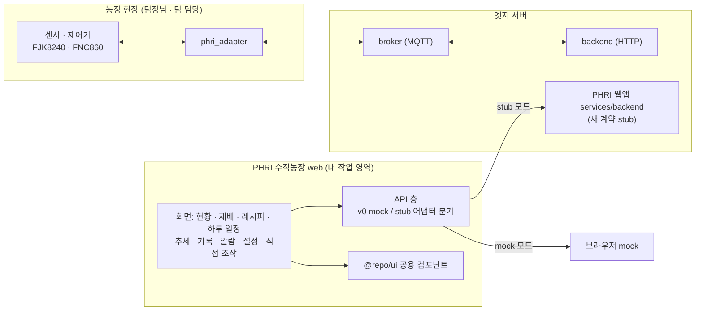

# 수직농장 (arav2)

- **한 줄 요약**: 엣지 기반 스마트팜 플랫폼(arav2) 위의 PHRI 수직농장 전용 웹앱에서, 운영 화면 UX 재정비 · 새 백엔드 계약(stub) 연결 · 공용 UI 컴포넌트 확장을 맡아 10일간 56개 커밋으로 진행했다.

---

## 프로젝트 개요

| 항목 | 내용 |
| --- | --- |
| 무엇 | 농장 현장 **엣지 서버** 위에서 도는 스마트팜 플랫폼 `arav2`. 디바이스 ↔ 브로커(MQTT) ↔ 화면/웹앱 구조이며, 앱별 웹앱(팜스큐브, **PHRI 수직농장** 등)이 붙는다 |
| 목적 | 수직농장 챔버(1~3)의 환경(온도 · 습도 · CO₂ · PAR 등) 모니터링, 재배(실험) 일정 · 레시피(프리셋) 관리, 수동/직접 조작, 알람 · 기록 · 추세 조회를 연구원이 쉽게 쓰게 함 |
| 기간 (내 커밋) | 2026-10-07 ~ 2026-10-16 (작업일 5일: 10/07 · 10/08 · 10/14 · 10/15 · 10/16) |
| 내 커밋 수 | **56개** (merge 제외; merge 1건 `e6eac46a` 별도) |
| 브랜치 | 56개 모두 `feat/ui` (origin 포함)에만 있음 |
| 역할 | **PHRI 수직농장 웹앱 프론트엔드 UX · 공용 UI 컴포넌트 · stub 계약 연결 · UX 문서**. 브로커 · 디바이스 어댑터 · 제어 로직은 팀장님 · 팀 담당 |
| 저장소 | `github.com/rapha155/phri-vertical-farm-web` — 프론트만 분리한 단독 실행 저장소(비공개). `pnpm install` → `pnpm dev`로 브라우저 mock 모드 실행. 원본: `github.com/araplatformkd/arav2` `feat/ui` (로컬 `C:\src\_dev\수직농장`) |
| 규모 (참고) | `git --shortstat` 합계 기준 추가 46,660줄 · 삭제 16,701줄. 이 중 큰 몫은 생성 코드(orval stub 스키마)와 파일 이동이므로 수치 자체를 성과로 내세우지 않는 것이 좋다 |

---

## 배경과 문제 정의

### 사용자
- **연구원**(시설원예 연구 · 재배 실험 담당). `docs/ux/모니터링.md` §1이 정리한 사용 순간: 출근해서 "모든 챔버가 정상인가", 알람이 울렸을 때 "어느 챔버 · 무엇이 · 얼마나 벗어났나", 실험 진행 "오늘 며칠째 · 다음 변경은 언제", 현장 상황판(키오스크)에서 멀리서 이상 챔버 확인.
- 휴대폰 · 태블릿은 현장에서 **확인하고 짧게 처리하는** 용도(알람 확인, 직접 조작 해제, 재배 진행 보기 — `docs/ux/반응형.md`).

### 문제 (docs/ux · UI 제안 검토 문서에서 확인한 것)
- **"지금 전체가 정상인가"를 한 화면에서 볼 수 없었다**: 챔버 카드가 왼쪽 세로 목록이라 3번째 챔버가 스크롤 아래로 잘렸고, 챔버 상세는 탭 7개(개요 · 환경 · 조명 · 관수 · 유동팬 · 출력 · 일정)로 나뉘어 탭을 돌아야 했다(`모니터링.md` §9 AS-IS).
- **보는 화면과 조작 화면이 섞여 있었다**: 대시보드 안에 출력 · 수동 조작 · 지금 관수가 있었다(`설정.md` §16).
- **화면 말이 어려웠다**: 실험 프리셋 · 제어 프리셋 · 복제본 · 고아 설정 · 배치 같은 PRD · 내부 용어가 그대로 화면에 나왔고, 한 대상에 이름이 둘인 경우도 있었다(`문구.md` §5 · §6).
- **연구원 UI 제안서(0920, 12장)와 구현의 차이**: 시안 대비 대시보드 카드 정보량(파장 비율 · 유동팬 모드 · 다음 목표 값), 챔버 단위 장기 추세 화면, 타임라인의 오늘 · 달력 날짜 등이 비어 있었다(`UI제안_0920_검토.md` §1~§3).
- **상태 표시가 정상처럼 보이는 오류**: 불러오기 실패 시 `0개` · `0건`이 "없음"으로 읽히고, 연결이 끊겨도 상세 값이 진하게 남았다(`상태.md` §2). 휴대폰에서는 행 끝 `[확인]` 버튼이 있는 표 5개가 화면 밖으로 넘쳤다(`반응형.md` §2).
- **새 백엔드 계약**: 웹앱 서비스(stub)가 기존 v0 계약과 도메인 모델이 달라, 화면을 어디까지 그대로 연결할 수 있는지 정해야 했다(`docs/stub_연결.md`).

### 목표
1. 1440×900에서 **스크롤 없이 한 화면**으로 모든 챔버 상태를 보고, 이상 챔버로 바로 들어간다(PRD D-4 기준).
2. 대시보드는 **보는 화면**으로 두고, 조작은 비상정지만 바로 노출하고 나머지는 한 단계 깊게(설정 › 직접 조작).
3. 화면 말을 **연구원이 떠올리는 말**로(현황 · 재배 · 레시피 · 하루 일정 · 기록) — 코드 · 라우트 · API 이름은 유지.
4. 화면만으로 할 수 없는 것은 **백엔드 요청(BR 번호)** 으로 분리해 기록한다.
5. 작업 전에 `docs/ux`에 UX를 먼저 정리하고 그 문서를 기준으로 구현한다(사람과 AI 코딩 에이전트 공통 규칙).

### Before → After

| 구분 | Before | After |
|---|---|---|
| 챔버 목록 배치 | 왼쪽 세로 목록, 3번째 챔버가 스크롤 아래로 잘림 | 위쪽 가로 카드 줄 — 정상 한 줄 + 예외만 바닥 줄 (`672562a`) |
| 챔버 상세 | 탭 7개 | 개요 한 화면 + 카테고리 상세 다이얼로그(`?detail=lighting` 등 URL로 열림) (`672562a`) |
| 조작 위치 | 대시보드 안 출력 · 수동 조작 · 지금 관수 | 대시보드는 보기 전용, 설정 › 직접 조작으로 이동 (`58c258f`) |
| 화면 용어 | 대시보드 · 실험 · 실험 프리셋 · 제어 프리셋 · 이력 | 현황 · 재배 · 레시피 · 하루 일정 · 기록 (`ef0643d`) |
| 장기 추세 | 챔버 단위 추세 화면 없음(대시보드 6시간~3일 · 실험 데이터 탭만) | `/trends` — 챔버 · 기간(7 · 14 · 30일) · 기간 요약 · 재배 시작/끝 세로선 · CSV (`58c258f`, UI 제안 T-1) |
| 실험(재배) 상세 탭 | 7개 | 5개(요약 · 추세 · 일정 · 알람 기준 · 기록) (`a164396`) |
| 휴대폰 표 | 행동 열이 있는 표 5개가 390px에서 가로로 넘침 | 행동 열 있는 표 4개를 행 카드로 쌓음, 편집 격자 1개는 의도적으로 유지 (`0852594`) |
| 실패 · 끊김 표시 | 실패해도 `0개` · `0건`, 끊겨도 상세 값이 정상처럼 | 개수 숨김 · 상세도 흐림 + `연결 끊김 · n초 전` (`510ca022`) |
| 백엔드 연결 | v0 계약(mock)만 | mock / stub 모드 전환, 겹치는 4개 화면을 어댑터로 연결 (`d77dc4e`) |

---

## 기술 스택

저장소 파일(`web/package.json`, 커밋 내용)로 확인한 것만 적었다. "내 작업" 열은 이 개발자가 커밋으로 직접 다룬 것.

| 영역 | 기술 | 내 작업 |
| --- | --- | --- |
| 프론트엔드 | React, TypeScript, Vite (`vite --mode stub` 등 모드 분기) | ✅ |
| 라우팅 · 상태 | react-router-dom, zustand | ✅ |
| 폼 · 검증 | react-hook-form, zod, @hookform/resolvers | ✅ (오류 표시 시점 `onTouched` 규칙) |
| UI 기반 | react-aria-components, Tailwind CSS, lucide-react, 사내 `@repo/ui` · `@repo/design` | ✅ (`@repo/ui` 컴포넌트 확장) |
| API 클라이언트 | orval (OpenAPI → 클라이언트 생성), 커스텀 mutator | ✅ (stub 타깃 · `stubMutator` 추가) |
| 날짜 | date-fns, @date-fns/tz | ✅ |
| 테스트 | Vitest, Testing Library, jsdom | ✅ (util · 컴포넌트 spec 추가) |
| 모노레포 | pnpm workspace, Turborepo | (사용) |
| 웹앱 서비스 | NestJS 기반 `services/backend` (stub 응답), MongoDB | ❌ (연결만 함) |
| 플랫폼 백엔드 · 브로커 | NestJS `apps/backend` · `apps/broker`, MQTT, PostgreSQL · MongoDB | ❌ 팀장님 · 팀 |
| 디바이스 어댑터 · 센서 | `apps/phri_adapter`(FJK8240, FNC860), 시뮬레이터 | ❌ 팀장님 담당 |
| AI 코딩 도구 | Claude Code / Codex용 `CLAUDE.md` · `AGENTS.md` 지침 | ✅ (지침 갱신 2건) |

---

## 아키텍처 / 구조

- 전체 시스템은 **디바이스 ↔ 브로커(MQTT, 실시간) / 백엔드(HTTP, 조회 · 설정) ↔ 화면 · 웹앱** 구조다. 센서 수집 · 자동 제어 경로는 팀장님과 팀의 작업이다.
- 이 개발자의 작업 영역은 **PHRI 웹앱의 `web/`** 과 **`packages/ui`** 다. API 층에서 v0 계약(`openapi.v0.json`, mock)과 새 서비스 계약(stub)을 `isStubApi()` 하나로 갈라, 화면 컴포넌트는 그대로 두고 데이터 출처만 바꿀 수 있게 했다.

---

## 주요 기능

> 아래 화면은 모두 분리 저장소(`phri-vertical-farm-web`)를 `pnpm dev`(브라우저 **mock** 모드)로 띄워 1440×900에서 캡처했다. 챔버 · 재배 · 사용자(`researcher`) · 장비 ID는 모두 mock 데이터다. 센서 수집 · 자동 제어 · 브로커는 팀장님 · 팀 담당이며, 여기서 보이는 것은 그 데이터를 보여 주는 **화면(이 개발자 담당)** 이다.

### 현황 대시보드

- 위쪽 카드 줄에 모든 챔버: 운전 상태 칩 · 재배 이름 · `6일째 · 8일 남음` · 온도 · 습도 · CO₂ 현재/목표, 장비 한 줄(정상 상태), **예외만** 바닥 줄(알람 n · 직접 조작 n · 조명 상한 · 모의 운전)(`672562a`, `22b2008`).
- 아래는 고른 챔버의 개요 한 화면 — 환경 그래프(6시간~3일), 조명 목표 파장(W · R · B · FR · UV-A %), 관수 회차 · 배액/공급 EC · pH, 유동팬 간헐 운전 문구, 카드마다 `다음 목표 변경 20:00 · 2시간 32분 남음 · 온도 19.0 ℃ …`(UI 제안 D-1 · D-2 · D-3 · D-4, `58c258f`).

### 챔버 상세 다이얼로그

- 카테고리 카드를 누르면 URL(`?detail=lighting`)로 열리는 다이얼로그. 재배단별 `일정 켜짐` · `실제 켜짐`, 파장 비율, 단별 목표 · 실제 켜짐 그래프. 탭 7개를 없애되 탭 화면을 다이얼로그로 재사용(`672562a`, `9c9cebc`).

### 재배 (실험 레코드)

- 목록은 재배 중 · 시작 전 · 지난 재배로 묶고 진행 막대 표시. 상세 탭 5개(요약 · 추세 · 일정 · 알람 기준 · 기록), 첫 재배 자동 선택(`a164396`, `e986369`).
- 요약: `일정과 다르게 직접 조작 중` 배너(→ 직접 조작), 현재 환경, 오늘 적용 중인 하루 일정의 한 줄 요약(UI 제안 S-1).

### 레시피(프리셋) 편집기

- 환경 · 조명 · 관수 · 유동팬 네 줄 × 일차 일정표에 하루 일정 카드를 끌어 넣고, 오른쪽 끝을 끌어 길이를 조절. 키보드(←/→ 이동 · Shift+←/→ 길이 · Delete)도 지원.
- `준비 완료`는 모든 일정표가 빈 구간 없이 채워져야 저장 가능 — 막힌 이유를 저장 바에 표시(`cf9c5f4`). 작물 · 품종은 이 자리에서 `CreatableComboBox`로 바로 만든다(`3acbe89`, `58c258f`).

### 오늘 운전 (새 서비스 계약)

- 새 계약의 운전 스케줄을 챔버별로 보여 주고 고친다: 카테고리 탭 · 24시간 목표 그래프 + `지금` 세로선 · 행 표 편집, 오른쪽에 다른 카테고리 요약(`d77dc4e`).
- 직접 조작 중인 항목이 있으면 "일정대로 되돌린 뒤에 적용됩니다" 경고와 `직접 조작` 링크. 직접 조작 화면(설정 › 직접 조작)은 환경 · 조명 · 관수 · 유동팬 · 장비 점검 카드 5장, 1시간 넘으면 경고(`d77dc4e`, `ce19f09`).

### 알람

- 기본 보기는 **해제 전**, 보기마다 건수(`해제 전 2 · 해제됨 2 · 전체 4`), 심각도 · 챔버 필터, 7열 표(심각도 · 상태 · 챔버 · 제목 · 값 · 발생 · 확인)(`0815455`, UI 제안 A-1).
- 상태 칩은 색 없이 아이콘으로(확인 전 종 · 확인됨 시계), 색은 심각도만 맡는다.

### 기록

- 기록 · 알람 두 탭, 종류 칩(전체 · 사람이 한 일 · 자동 제어 · 알람 · 시스템), 기간 24시간~30일 · 직접 선택, 검색, CSV(`e5f7b94`). 지난 재배 비교는 재배 메뉴(`/runs/compare`)로 옮김.

### 설정 › 시스템 상태

- 맨 위 `마지막 확인 17:29:49 · 10초마다`와 전체 판정 한 줄(`모두 정상` / `확인 필요 n건`). 서버가 응답하지 않으면 "서버 응답 없음 — 시각 기준 상태" 경고로 지난 값과 지금 값을 구분(`2201182`, 기술적 문제 해결 사례 2).

### 휴대폰 (390px)

- `pad` 미만에서는 챔버 목록 → 상세(`← 챔버 목록`), 아래 탭 바. 직접 조작 중 · 알람 같은 예외는 카드 바닥 줄에 그대로 남는다(`0852594`, `d7d970b`).

### 다크 테마

- 표시 설정의 테마(`data-theme="evergreen-dark"`)로 8화면 axe 대비 검사 위반 0. 다크에서 목표선이 켜짐 띠에 묻히던 차트는 띠를 옅게(0.25 → 0.12) 조정(`0a85279`).

---

## UX 설계 원칙

이 개발자가 `docs/ux/`에 정리하고 구현 기준으로 쓴 규칙이다(README 포함 문서 15개 + 레퍼런스 2개, 근거 자료는 PRD · 연구원 UI 제안서).

| 원칙 | 내용 | 근거 문서 · 커밋 |
|---|---|---|
| **UX 선행 정리** | 화면 작업 전에 `docs/ux/`에 화면 · 흐름 단위로 UX를 먼저 정리하고 그 문서를 기준으로 구현. 화면만으로 안 되는 것은 `백엔드_요청.md`(BR-1~13)로 분리. 같은 규칙을 `CLAUDE.md` · `AGENTS.md`에 넣어 AI 코딩 에이전트도 따르게 함 | `docs/ux/README.md`, `315becb` |
| **보는 화면 / 조작 화면 분리** | 현황은 보는 화면 — 비상정지만 상단 바에 상시 노출, 직접 조작은 설정 › 직접 조작으로 한 단계 깊게. 누르기 전에 영향 범위(`출력 15개 → 켜짐`)와 복귀 여부를 보여 줌 | `모니터링.md` §6.2, `설정.md` §16, `3d3cb0b` |
| **예외만 표시** | 정상 · 일정대로 · 사용 가능은 칩 없이 조용히. 같은 숫자 · 상태를 한 화면에서 두 번 말하지 않음 | `개선_계획.md` §0, `모니터링.md` §10 |
| **문구 규칙** | 화면 표기는 연구원이 떠올리는 말(현황 · 재배 · 레시피 · 하루 일정 · 기록), 내부 용어(복제본 · 고아 · 배치 · DAT) 금지, 한 대상은 어디서나 한 이름. 코드 · 라우트 · API 키는 그대로. 자리별 말투(행동 안내는 하십시오체, 토스트는 ~했습니다, 칩 · 라벨은 명사형)와 마침표 규칙 | `문구.md` §1 · §2 · §5 · §6, `ef0643d`, `2a18d6e` |
| **버튼 위계** | 채운 버튼(primary)은 "그 화면에서 가장 많이 하는 일" 하나에만. 보는 화면(현황 · 재배 · 기록)은 0개, 편집 · 설정 폼은 `저장`, 표 행의 행동은 회색 | `컴포넌트.md` §3.3, `58f0551` |
| **입력 오류 시점** | 칸이 몇 개뿐인 대화상자 폼은 저장할 때 처음 검사, 칸이 수십 개인 행 표 편집기는 칸을 떠날 때(`onTouched`) | `컴포넌트.md` §3.4, `b7358d8` |
| **화면 상태** | 처음 로딩은 실제 모양의 스켈레톤, 본 뒤 실패는 값을 지우지 않고 경고 배너, 모르는 개수는 `0`으로 쓰지 않고 숨김, 권한 없으면 버튼을 숨기지 않고 막고 이유 표시. `?mockFault=error/down`으로 재현 | `상태.md`, `510ca022` |
| **반응형** | 주 화면은 1440 데스크톱 · 상황판, 휴대폰은 현장 확인용. 행 끝에 행동이 있는 표는 `tablet` 미만에서 행 카드로 쌓고(`title` · `meta` · `trailing` 슬롯), 입력 격자는 쌓지 않음 | `반응형.md` §3, `0852594`, `a87e90d` |
| **접근성 (WCAG 2.2 AA 목표)** | 상태를 색만으로 알리지 않음(아이콘 + 문구 / 숨은 문구), 흐림은 글자 `opacity` 대신 바탕 · 테두리로, `scrollIntoView` 금지(Tab 출발점이 바뀜), 행동 열 머리는 `sr-only` 이름, 매초 바뀌는 값은 실시간 영역에서 제외 | `접근성.md` §3 · §4, `2908f0a` |

---

## 내가 한 일

### AI 코딩 에이전트 협업 지침

- **에이전트 지침에 "UX 선행 정리" 규칙 추가** (`315becb`, 10/07): PHRI 앱의 `CLAUDE.md` · `AGENTS.md`에 "화면 작업 전에 `docs/ux/`에 UX를 먼저 정리하고 그 문서를 기준으로 구현한다" 규칙을 넣고 `docs/ux/`를 새로 만듦. AI 코딩 에이전트(Claude Code · Codex)가 같은 규칙을 따르게 한 설정.
- **에이전트 지침에 stub 연결 안내 추가** (`d77dc4e`, 10/15): `CLAUDE.md`에 "새 서비스 계약(stub) 연결" 절과 `docs/stub_연결.md` 링크 추가.

### PHRI 수직농장 웹앱 프론트엔드

**1. 새 서비스 계약(stub) 연결 · 운전 화면** — `d77dc4e` (10/15)
- orval에 `stub` 타깃 추가(`services/backend/openapi.json` → `src/api/stub/generated/`), mock을 거치지 않는 `stubMutator` · `fetchStubFile`, `pnpm dev:stub` 모드.
- 추세 · 기록 › 활동 · 알람 · 설정 일반 화면을 **stub DTO → v0 뷰모델 어댑터**(순수 함수 `*.adapter.ts`)로 연결. 개념이 다른 화면(제어 프리셋 · 챔버 일정 · 수동 운전)은 연결하지 않고 이유를 문서화.
- 오늘 운전(`/chambers/:no/operation`) · 운전 일정(`/presets/operation`) · 직접 조작(카드 5장 · 결과 창 · 1시간 경고) 화면, 상태를 저장하는 새 계약 mock 라우트.
- 후속 정리 `ce19f09` (10/16): 직접 조작 상태 · MANUAL 판정 · 무효화 키를 한 곳으로, `useToastAction` · `useCanAct`(Can 컴포넌트 대체), 데이터 출처 분기를 함수 하나로, 자동 갱신 주기 표(`POLL_MS`), 옛 수동 조작(overrides) 코드 삭제.

**2. 연구원 요청 · UI 제안 반영** — `58c258f` (10/14), `2e7c36d` (10/16)
- UI 제안서(0920) 검토 문서 작성 + P1~P3 항목 반영(대시보드 파장 · 유동팬, 추세 화면, 광주기 막대, EC/pH 선, 관수 하루 타임라인 등).
- 설정 › 작물 · 장비 제거(작물 · 품종은 프리셋 편집에서 `CreatableComboBox`로 바로 생성), 설정 › 수동 운전 신설 — 출력 · 수동 조작 · 지금 관수를 대시보드에서 옮겨 대시보드는 보기 전용.
- 알람 기준 표 개편(사용 · 측정 · 기준 · 지속 시간 · 심각도 5열, 히스테리시스는 고급 편집), `docs/ux/개선_계획.md`에 광량 비례 관수 설계 정리, 백엔드 요청 BR-12(광량 비례 관수) · BR-13. *광량 비례 관수 제어 로직 자체는 팀장님 지침 기반이며 이 개발자는 화면 · 요청 문서 작업.*

**3. 화면 용어 · 문구 쉬운 말로** — `ef0643d` (10/15), `ce19f09`, `2a18d6e`, `322d628`
- ko · en 화면 용어를 현황 · 재배 · 레시피 · 하루 일정 · 기록 등으로 정리(키 · 라우트 · API는 유지), `docs/ux/문구.md` 용어 대응표, 해요체 · 마침표 규칙 정리, 영어 "Test run" 통일.

**4. 대시보드 · 알람 · 기록 화면 개편** — 10/07 ~ 10/15
- 대시보드: 카드 줄 상단 배치 · 개요 + 상세 다이얼로그 · 알람 기준 편차 판정 · 키오스크(`672562a`), 재배단별 켜짐 표시(`22b2008`), 카드 선택 표시(`4f271be`, `a54cef0`), 상황판 그래프 높이 기준 확대(`2cd495f`), Home Assistant 비교 반영 아이콘 정리(`9c9cebc`).
- 알람: 열림 기본 · 표 7열 · 위험 알람 배너(`0815455`).
- 기록: 활동 · 알람 두 탭, 종류 칩 5개, 관리자 전용 상세 정보 접기, 지난 재배 비교를 `/runs/compare`로 이동(`e5f7b94`); 이벤트 표 예외만 표시 · 완료 실험 비교 겹쳐 그리기(`6ec04d9`, `d25d364`).

**5. 실험 · 프리셋 · 설정 화면 정리** — 10/07 ~ 10/08
- 실험 상세 탭 7→5(`a164396`), 첫 실험 자동 선택 · 계획 변경 결과 요약(`e986369`), 배치 겹침 차단 · 가장 빠른 빈 시작일 제안(`72a3059`), 수동 조작 결과 미리보기 · 비상정지 안내(`3d3cb0b`).
- 프리셋: 보관/영구 삭제 구분 · 사용 중 삭제 차단(`48a4428`), 편집기 오류 시점 `onTouched`(`b7358d8`), 저장 막힘 안내(`cf9c5f4`).
- 설정: 시스템 상태(마지막 확인 시각 · 응답 없음 경고 · 전체 판정, `2201182`), 백업(`7f2bac9`), 사용자 권한 표시(`fab22ba`), 일반 · 챔버 · 알림 · 데이터(`6f4565c`), 출력 다이얼로그(`d1f052c`, `b87ecef`, `6dfde32`).

**6. 반응형 · 접근성 · 테마** — 10/07 ~ 10/08
- 휴대폰에서 행동 열 있는 표 쌓기(`0852594`), 표 열 정리 · `minBreakpoint`(`a87e90d`), 접근성 점검(Tab 순서 · 색 외 알람 표시 · 대비, `2908f0a`), 다크 테마 점검(`0a85279`), 버튼 위계 규칙(`58f0551`).

**7. 공용 UI 컴포넌트 (`@repo/ui`)** — 6건
- `Checkbox isIndeterminate`(`db3b8bd`), 스켈레톤 · 진행 막대 바탕 수정(`a563798`), `CreatableComboBox` · `DataTable isFormTable` · `LiveClock dateLocale`(`3acbe89`), `Banner onDismiss`(`5951255`), `Slider isValueHidden` · LiveClock 숫자 폭(`0d6f24c`), `TextLink tone` · 차트 자정 눈금 · `isXAxisHidden`(`9623747`).

**8. 문서**
- `docs/ux` 신설 · Home Assistant 레퍼런스 분석(`315becb`), 모니터링 UX · 컴포넌트 규칙 · Tremor 레퍼런스(`9b401bd`), 상황판 글자 크기 결정(`41ec031`), 비개발자용 학습 문서 `docs/learning/`(핵심 아키텍처 · 브로커 · 토픽 용어, 561줄, `7670518`).

---

## 기술적 문제 해결 사례

### 1. 계약이 다른 두 백엔드를 화면 수정 없이 연결 (`d77dc4e`, `ce19f09`)
- **문제**: web은 v0 계약(mock)으로 만들어졌는데, 새 웹앱 서비스(stub)는 도메인 모델이 다름(챔버 경로 `{no}` ↔ 쿼리 `zid`, 실험 레코드 ↔ 프로그램, 카테고리별 프리셋 ↔ 4종 묶음 + 폴더). `/v1/alarms` · `/v1/settings`는 경로까지 같아 경로로 가를 수 없었다.
- **해결**: orval에 stub 타깃을 추가해 클라이언트를 생성하고, `stubMutator`로 mock을 우회해 실제 서비스로 보냄. stub DTO ↔ v0 DTO 변환을 순수 함수 어댑터로 분리하고, 화면 훅은 `isStubApi()`로 출처를 고르게 함. zid 0(공용 구역)은 `chamberNo: null`(사이트 전체)로 매핑. 이후 데이터 출처 분기를 함수 한 곳으로 모음.
- **결과**: 겹치는 4개 화면(추세 · 활동 기록 · 알람 · 설정 일반)을 화면 컴포넌트 변경 없이 연결. 개념이 다른 3개 화면은 억지로 붙이지 않고 연결 불가 사유와 백엔드 요청 목록을 `docs/stub_연결.md`에 남김.

### 2. 서버가 응답하지 않을 때 지난 값을 현재 값처럼 보여 주는 문제 (`2201182`)
- **문제**: 설정 › 시스템 상태에서 다시 받기가 실패해도 이전 값이 그대로 남아 정상처럼 보였고, 10초마다 스피너가 깜빡였다.
- **해결**: `useResource`가 마지막으로 받은 시각(`updatedAt`)을 함께 돌려주게 하고, 실패 시 "서버 응답 없음 — 시각 기준 상태" 경고와 흐림 처리. 맨 위에 전체 판정 한 줄(모두 정상 / 확인 필요 n건), 문제만 색 칩으로 표시. 스피너 제거.
- **결과**: 오래된 값과 현재 값을 구분할 수 있게 됨.

### 3. 스켈레톤 · 진행 막대가 페이지 바탕 위에서 안 보이는 문제 (`a563798`)
- **문제**: 바탕색이 `surface-subtle`(페이지 바탕과 같은 색)이라 페이지 위 스켈레톤은 통째로, 진행 막대는 빈 구간이 보이지 않았다.
- **원인**: 놓이는 면(카드 / 페이지)에 따라 대비가 달라지는 불투명 토큰을 썼다.
- **해결**: 네 테마 모두에 있는 반투명 `fill` · `fill-strong` 토큰으로 교체.
- **결과**: 카드 · 페이지 어느 면 위에서도 보이게 됨(공용 `@repo/ui` 수정이라 모든 앱에 적용).

### 4. 일부 선택 상태가 "전체 해제"처럼 보이는 문제 (`db3b8bd`, `7f2bac9`)
- **문제**: 백업 내보내기에서 묶음 체크박스가 하위 일부 선택을 꺼짐으로 표시해 일부 선택인지 전부 해제인지 구분이 안 됐다.
- **해결**: 공용 `Checkbox`에 react-aria의 `isIndeterminate`를 연결하고 −로 그림. 백업 화면 전체 선택에 적용.

### 5. 화면 문구와 내부 용어가 섞여 연구원이 헷갈리는 문제 (`ef0643d`, `ce19f09`)
- **문제**: 같은 대상에 두 이름, 내부 용어, 모호한 주어가 화면에 섞여 있었다.
- **해결**: ko · en 화면 용어를 쉬운 말로 바꾸되 i18n 키 · 라우트 · API 이름은 유지해 코드 영향을 줄임. `docs/ux/문구.md`에 용어 대응표를 두고 PRD 화면 표기 열을 맞춤.

---

## 타임라인

| 날짜 | 커밋 수 | 주요 내용 |
| --- | --- | --- |
| 2026-10-07 | 22 | `docs/ux` · 에이전트 지침 UX 선행 규칙, 대시보드 개편, 알람 UX, 실험 상세 탭 정리, 반응형 · 접근성 점검 |
| 2026-10-08 | 23 | 다크 테마 · 버튼 위계, 출력 다이얼로그, 실험 · 프리셋 · 이력 · 설정 화면 정리, `Checkbox` 중간 상태, 스켈레톤 수정 |
| 2026-10-14 | 2 | UI 제안(0920) 반영, 설정 › 수동 운전 신설, `CreatableComboBox` |
| 2026-10-15 | 5 | 화면 용어 쉬운 말로, 기록 화면 정리, 학습 문서, **새 서비스 계약(stub) 연결 · 오늘 운전 · 직접 조작** |
| 2026-10-16 | 4 | 직접 조작 · 재배 화면 정리 · 상태 관리 단순화, 알람 기준 표 개편, 광량 비례 관수 설계 문서, 공용 UI 옵션 추가 |

---

## 포트폴리오용 핵심 성과 문장

- 엣지 스마트팜 플랫폼의 PHRI 수직농장 웹앱(React · TypeScript · Vite)에서 10일간 56개 커밋으로 대시보드 · 재배 · 알람 · 기록 · 설정 화면 UX를 재정비.
- 도메인 모델이 다른 신규 백엔드 계약을 orval stub 타깃 · 커스텀 mutator · 순수 함수 어댑터로 연결해, 화면 컴포넌트 수정 없이 4개 화면을 mock/실서비스 모드 전환 가능하게 구성.
- 오늘 운전 · 운전 일정 · 직접 조작 화면을 새로 만들고, 직접 조작 상태 · 캐시 무효화 · 데이터 출처 분기를 한 곳으로 모아 상태 관리를 단순화.
- 사내 공용 UI 라이브러리(`@repo/ui`)에 `CreatableComboBox`, `Checkbox` 중간 상태, `Banner` 닫기 등 6건의 컴포넌트 기능 · 수정을 추가해 여러 앱에서 재사용 가능하게 함.
- 연구원 요청과 UI 제안서를 검토 문서로 정리해 반영하고, UI만으로 해결할 수 없는 항목은 백엔드 요청(BR 번호)으로 분리해 관리.
- `docs/ux` 기반 "UX 선행 정리" 규칙을 만들고 이를 AI 코딩 에이전트 지침(`CLAUDE.md` · `AGENTS.md`)에도 반영해, 사람과 에이전트가 같은 UX 문서를 기준으로 구현하도록 정리.
- 반응형(휴대폰 표 쌓기) · 접근성(Tab 순서, 색 외 상태 표시, 대비) · 다크 테마 점검을 수행.

---

## 성과 지표 요약

성능 수치 같은 운영 지표는 없다(mock · stub 단계의 프론트 작업). 아래는 커밋 · `docs/ux` 점검 기록에 남은 수치만 옮겼다.

| 지표 | Before | After | 근거 |
|---|---|---|---|
| 작업 규모 | — | 10일(작업일 5일) · 커밋 56개 | `git log` |
| 연구원 UI 제안서(0920) 반영 | 화면에 없는 · 개선할 항목 정리 | P1 8개 · P2 14개 · 화면만으로 되는 P3 6개 반영, 남은 것은 백엔드 항목만 | `UI제안_0920_검토.md` §1, `58c258f` |
| 백엔드 요청 분리 | — | BR-1 ~ BR-13 (화면만으로 안 되는 것) | `docs/백엔드_요청.md` |
| 새 계약(stub) 연결 | v0 mock만 | 겹치는 4개 화면 어댑터 연결, 개념이 다른 3개 화면은 사유 문서화 | `d77dc4e`, `docs/stub_연결.md` |
| 챔버(현황) 상세 | 탭 7개 | 개요 한 화면 + 카테고리 다이얼로그 | `672562a`, `모니터링.md` §9 |
| 재배(실험) 상세 탭 | 7개 | 5개 | `a164396` |
| 접근성 axe 자동 검사 (13화면 × 1440 · 10화면 × 390) | 위반 2종 | 0 | `2908f0a`, `접근성.md` §1 |
| 다크 테마 axe 대비 검사 (8화면) | — | 위반 0 | `0a85279`, `접근성.md` §6 |
| 휴대폰(390px) 표 넘침 | 표 17개 중 `mobile` 슬롯 0개 → 5개 넘침 | 행동 열 있는 4개 쌓기, 편집 격자 1개 의도적 유지 | `0852594`, `반응형.md` §2 |
| 휴대폰 재배 요약 환경 영역 높이 | 565px | 171px | `d7d970b`, `반응형.md` §4 |
| 화면 문구 말투 점검 | ko 문구 1,619개 중 규칙 어긋남 9개 | 9개 수정 | `2a18d6e`, `문구.md` §3 |
| 채운 버튼 2개였던 화면 | 3곳(프리셋 상세 · 장비 · 백업) | 화면당 1개 이하 | `58f0551`, `컴포넌트.md` §3.3 |
| 공용 UI(`@repo/ui`) 기여 | — | 6건(컴포넌트 옵션 추가 · 수정) | 위 "공용 UI 컴포넌트" 절 |

## 배운 점 · 회고 (초안 — 본인 확인 후 수정)

- **문서를 먼저 쓰면 결정이 남는다.** `docs/ux`에 "왜 이렇게 했는지 · 시안과 무엇이 다른지"를 남기니(예: 카드 스파크라인을 뺀 이유 — 1440×900에서 49px 넘침), 다음 변경 때 같은 논의를 반복하지 않았다. 같은 규칙을 AI 코딩 에이전트 지침에 넣어 사람과 에이전트가 같은 기준으로 작업하게 한 것도 효과가 있었다.
- **화면만으로 안 되는 것은 억지로 만들지 않는다.** 새 계약과 개념이 다른 3개 화면은 어댑터로 붙이지 않고 사유를 남겼고, `오늘 해제 n`처럼 근사치일 수밖에 없는 값은 근사치라고 문서에 적고 백엔드 요청(BR-1)으로 넘겼다.
- **"정상처럼 보이는 오류"가 가장 위험하다.** `0건`, 진하게 남은 지난 값, 일부 선택이 해제처럼 보이는 체크박스 — 모두 사용자를 안심시키는 잘못된 신호였다. 모르는 값은 숨기고, 오래된 값은 시각과 함께 흐리게 보이는 쪽을 택했다.
- **쉬운 말은 코드 변경 없이도 큰 차이를 만든다.** 화면 표기와 도메인 용어를 대응표로 분리하고, i18n 키 · 라우트 · API는 그대로 두어 영향 범위를 문구 파일로 한정했다. 다만 `추세 → 그래프 → 추세`처럼 되돌린 경우도 있어, 용어는 연구원이 실제로 부르는 말을 먼저 확인해야 한다는 것을 배웠다.
- **자동 점검은 방법까지 검증해야 한다.** 다크 테마 첫 점검은 브라우저 색 모드만 바꿔 실제로는 다크가 아니었다 — `data-theme`를 직접 바꿔 다시 점검했다(`접근성.md` §6).
- (확인 필요) 실제 스크린리더(NVDA · VoiceOver) 점검과 현장 연구원 사용성 확인은 아직이다.

## 면접 예상 질문

1. **도메인 모델이 다른 새 백엔드 계약을 어떻게 연결했나?**
   - orval에 stub 타깃을 추가해 클라이언트를 생성하고, mock을 우회하는 `stubMutator`로 실제 서비스에 보냄.
   - stub DTO → v0 뷰모델 변환을 순수 함수 어댑터(`*.adapter.ts`)로 분리, 데이터 출처 분기는 `isStubApi()` 한 곳. 화면 컴포넌트는 그대로 두고 겹치는 4개 화면만 연결.
   - 개념이 다른 화면(제어 프리셋 · 챔버 일정 · 수동 운전)은 억지로 붙이지 않고 사유와 백엔드 요청을 문서화(`d77dc4e`, `ce19f09`).
2. **대시보드 상세의 탭 7개를 왜 없앴나?**
   - 탭은 "지금 전체가 정상인가"를 가린다 — 개요 한 화면(훑기) + 카테고리 다이얼로그(파고들기)로 나눔.
   - 기존 탭 화면(약 1,700줄)을 다이얼로그로 재사용해 같은 화면이 두 벌이 되지 않게 함. 서랍 대신 다이얼로그를 고른 이유는 재배단 차트 폭과 휴대폰에서 아래 시트로 바뀌는 점(`모니터링.md` §10).
3. **연구원 UI 제안서는 어떻게 반영했나? 그대로 다 넣었나?**
   - 12장을 현재 구현과 하나씩 대조해 `UI` / `UI · 확인` / `백엔드`로 나누고 P1~P3 우선순위를 매김.
   - 그대로 넣지 않은 것도 이유와 함께 기록 — 예: 배액 EC와 공급 목표 EC는 다른 값이라 "현재/목표"로 짝짓지 않음, 스파크라인은 1440×900 높이 예산 때문에 뺌. 백엔드가 필요한 항목은 BR 번호로 분리.
4. **"화면 용어 쉬운 말로" 작업에서 코드 영향을 어떻게 줄였나?**
   - 화면 표기만 바꾸고 i18n 키 · 라우트 · API 이름은 유지. `문구.md`에 도메인 용어 ↔ 화면 표기 ↔ en 대응표를 두고, 조사(을/를 등) 변화까지 함께 고침(`ef0643d`).
5. **접근성은 어떤 기준으로 무엇을 고쳤나?**
   - WCAG 2.2 AA 목표, axe 자동 검사 · 키보드 · 접근성 트리 점검. 위반 2종 → 0.
   - 예: `scrollIntoView`가 Tab 출발점을 옮겨 첫 Tab이 챔버 카드로 가던 문제 → 스크롤 컨테이너만 이동. 지표 알람이 색으로만 보이던 문제 → 경고 아이콘 + 숨은 문구 `목표 이탈`(`2908f0a`).
6. **서버가 응답하지 않을 때 화면은 어떻게 동작하나?**
   - 처음 실패는 `불러오기 실패 · 다시 시도`, 본 뒤 실패는 값을 지우지 않고 경고 배너. 시스템 상태는 `updatedAt`을 함께 받아 "서버 응답 없음 — 시각 기준 상태"로 표시하고 스피너 깜빡임 제거(`2201182`).
   - `?mockFault=error/down`으로 mock에서 재현 가능하게 함.
7. **팀 프로젝트에서 본인 범위는 어디까지였나?**
   - PHRI 웹앱 프론트(`web/`) · 공용 UI(`packages/ui`) · UX 문서 · stub 계약 연결. 센서 · 디바이스 어댑터 · 브로커 · 자동 제어 로직은 팀장님과 팀 담당이고, 광량 비례 관수도 제어 로직이 아니라 화면 설계와 백엔드 요청 문서를 맡음.

---

## 부록: 전체 커밋 목록

작성자 `KD-shhyeong <shhyeong@koreadigital.com>`, merge 제외 56개, 오래된 순. 브랜치는 `git branch -a --contains` 결과로, 56개 모두 `feat/ui`(origin 포함)에만 포함된다.

| 날짜 | 해시 | 브랜치 | 메시지 |
| --- | --- | --- | --- |
| 2026-10-07 | `315becb4` | feat/ui | docs(phri): UX 선행 정리 규칙 · docs/ux 신설, Home Assistant 레퍼런스 분석 |
| 2026-10-07 | `9b401bd9` | feat/ui | docs(phri): 모니터링 UX · 컴포넌트 규칙 초안, Tremor 레퍼런스 |
| 2026-10-07 | `600fc6e4` | feat/ui | feat(phri): 챔버 상태 칩 · ON/OFF 칩 표시 규칙 통합, 지연 기준 문서 정정 |
| 2026-10-07 | `672562aa` | feat/ui | feat(phri): 대시보드 개편 — 카드 줄 상단 배치 · 개요 + 상세 다이얼로그 · 알람 기준 편차 판정 · 판정 칩 정리 · 키오스크 |
| 2026-10-07 | `22b20089` | feat/ui | feat(phri): 근거 기반 미결 정리 · 조명/유동팬 카드에 재배단별 켜짐 표시 |
| 2026-10-07 | `08154557` | feat/ui | feat(phri): 알람 UX — 열림 기본 · 열림은 기간 무시 · 표 7열 · 드로어 정리 · 위험 알람 배너 |
| 2026-10-07 | `7980984e` | feat/ui | feat(phri): 프리셋 목록 사이드바 순서 통일 · 종류 필터 줄바꿈 · 가져오기/내보내기 아이콘 메뉴 |
| 2026-10-07 | `a1643969` | feat/ui | feat(phri): 실험 상세 탭 7→5(계획+복제본 · 이력 통합) · Workbench 스크롤바 자리 고정 |
| 2026-10-07 | `9167e570` | feat/ui | feat(phri): 설정 저장 바 전체 폭 · 폼 읽기 폭 분리 · 알람 팝업 설명 정정 |
| 2026-10-07 | `72a30593` | feat/ui | feat(phri): 배치 미리보기 공용화 · 겹침 시 배치 막음 · 가장 빠른 빈 시작일 제안 |
| 2026-10-07 | `3d3cb0b9` | feat/ui | feat(phri): 수동 조작 결과 미리보기 · 실험 중 경고 공용화 · 비상정지 짧은 누름 안내 |
| 2026-10-07 | `510ca022` | feat/ui | feat(phri): 화면 상태 정리 — 모르는 개수 숨김 · 중복 오류 제거 · 상세 연결 끊김 표시 · mockFault 스위치 |
| 2026-10-07 | `0852594d` | feat/ui | feat(phri): 휴대폰에서 행동 열이 있는 표 쌓기 — 알람 · 출력 · 이벤트 · I/O 포인트 · 반응형 UX 문서 |
| 2026-10-07 | `2908f0a0` | feat/ui | feat(phri): 접근성 점검 — 대시보드 첫 Tab 순서 · 카드 지표 알람 색 외 표시 · 지난 타임라인 대비 · 출력 행동 열 이름 |
| 2026-10-07 | `a87e90d7` | feat/ui | feat(phri): 남은 표 정리 — 빈 비고 열 숨김 · I/O 포인트 열 접기 · 행동 열 고정 · 챔버 이름 중복 제거, DataTable minBreakpoint 우선 |
| 2026-10-07 | `41ec0313` | feat/ui | docs(phri): M-8 결정 — 상황판 글자 크기는 사용자 표시 설정을 따름 |
| 2026-10-07 | `48c9a503` | feat/ui | feat(phri): 휴대폰 챔버 일정 — 날짜별 + 대신 실험 배치 버튼 하나 · 수동 조작 요약의 실시간 영역에서 복귀 시각 제외 |
| 2026-10-07 | `cf9c5f40` | feat/ui | feat(phri): 프리셋 편집기 점검 — 시각 칸 잘림 · 행 삭제 열 고정 · 저장 막힘 안내를 저장 바에(초안으로 바꾸기 · 검사 보기) |
| 2026-10-07 | `d25d364b` | feat/ui | feat(phri): 이력 점검 — 비교 차트 일차 축 · 요약 표 설명 · 행위자 이름 공용화 · 이벤트 종류 아이콘 · 중립 칩 시계 아이콘 정리 |
| 2026-10-07 | `c555252d` | feat/ui | feat(phri): 설정 나머지 점검 — 역할은 칩 대신 글자 · 품종 보관 버튼 아이콘 통일 |
| 2026-10-07 | `9c9cebc8` | feat/ui | feat(phri): Home Assistant 비교 — 카테고리 카드 아이콘 · 같은 대상 같은 아이콘 · 챔버 아이콘 · 상세 다이얼로그 컨테이너 · 선택 전 안내 가운데 |
| 2026-10-07 | `dc2619d9` | feat/ui | feat(phri): 설정 섹션 머리 통일 — PageBar(제목 · 행동 · 고정 높이) · 사용자 머리 · 백업/사용자 막대 칸 끝까지 |
| 2026-10-08 | `58f05510` | feat/ui | feat(phri): 버튼 위계 — 채운 버튼 화면당 하나(목록 만들기 · 표 행 확인 · 백업은 회색) |
| 2026-10-08 | `1a0eda09` | feat/ui | feat(phri): 시험 운전 칩 통일 · 보관됨 칩 공용화 · 차트 눈금 글자 토큰 · 매핑 결과 포인트 키 표시 |
| 2026-10-08 | `2cd495f6` | feat/ui | feat(phri): 상황판 그래프 확대를 높이 기준(tall:)으로 — 1600×900 넘침 · 화면 높이별 맞음 기록 |
| 2026-10-08 | `0a852799` | feat/ui | feat(phri): 다크 테마 점검 — 선과 함께 그리는 켜짐 띠를 옅게(@repo/ui) · 접근성 다크 기록 정정 |
| 2026-10-08 | `2a18d6e4` | feat/ui | docs(phri): 문구 말투 · 마침표 규칙 — 해요체 2 · 마침표 7 정리 |
| 2026-10-08 | `322d628d` | feat/ui | fix(phri): 영어 시험 운전 용어 Test run 하나로 |
| 2026-10-08 | `b7358d8d` | feat/ui | feat(phri): 제어 프리셋 편집기 오류 시점 — 칸을 떠날 때 처음 검사(onTouched) · 폼 오류 시점 규칙 |
| 2026-10-08 | `6da7fe2b` | feat/ui | feat(phri): 보관된 실험 프리셋 — 복제해서 다시 사용 안내 · 버튼 |
| 2026-10-08 | `d7d970b0` | feat/ui | feat(phri): 휴대폰 실험 개요 환경 한 줄(EnvMetricsCompact) · 행 편집 표 시각 열 고정 — DataTable isPinnedStart · 고정 칸 스크롤 여백 |
| 2026-10-08 | `4f271be6` | feat/ui | feat(phri): 대시보드 — 고른 카드 밑줄(테두리 겹침 해소) · 정보 알람 종 아이콘 · 다음 목표 변경 문구 · 그래프 기간 표시 |
| 2026-10-08 | `a54cef0f` | feat/ui | feat(phri): 대시보드 카드 — 고른 카드 테두리 전체(안쪽 고리로 3px) · 챔버 이름 title-2 · 이름 아래 여백 |
| 2026-10-08 | `d1f052c6` | feat/ui | feat(phri): 출력 다이얼로그 — 머리 고정(공용 Dialog 내용만 스크롤) · 표 자체 스크롤 · 칸 여백 · 이름 주 글자 · 실패 코드 문구 |
| 2026-10-08 | `b87ecef5` | feat/ui | feat(phri): 출력 다이얼로그 — 위치 필터 · 장비 특성 진단은 표 위 한 줄 · 창 높이 고정 |
| 2026-10-08 | `6dfde32b` | feat/ui | feat(phri): 출력 표 — 지금 상태 열 먼저 · 수동 조작 행 주의 바탕(DataTable getRowTone) |
| 2026-10-08 | `a5637988` | feat/ui | fix(ui): 스켈레톤 · 진행 막대 바탕을 반투명 fill 로 — 페이지 바탕 위에서 보이게 |
| 2026-10-08 | `e9863694` | feat/ui | feat(phri): 실험 화면 · 모달 — 첫 실험 자동 선택 · 수동 조작 배너 · 계획 변경 결과 요약 |
| 2026-10-08 | `48a4428d` | feat/ui | feat(phri): 프리셋 화면 · 모달 — 필터 알약 · 사용 현황 · 보관/삭제 구분 · 빈 구간 안내 |
| 2026-10-08 | `6ec04d96` | feat/ui | feat(phri): 이력 — 이벤트 표 예외만 · 완료 실험 비교 겹쳐 그리기 |
| 2026-10-08 | `6f4565c7` | feat/ui | feat(phri): 설정 — 일반 · 챔버 · 작물 · 장비 · 알림 · 데이터 화면 정리 |
| 2026-10-08 | `db3b8bdf` | feat/ui | feat(ui): Checkbox 중간 상태(isIndeterminate) — 일부 선택을 전체 선택 상자에 보인다 |
| 2026-10-08 | `7f2bac9a` | feat/ui | feat(phri): 설정 백업 — 가져온 결과 링크 · 미리보기 줄이기 · 일부 선택 표시 · CSV 라벨 줄 맞춤 |
| 2026-10-08 | `2201182f` | feat/ui | feat(phri): 설정 시스템 상태 — 마지막 확인 시각 · 응답 없음 경고 · 전체 판정 · 문제만 색 |
| 2026-10-08 | `fab22bac` | feat/ui | feat(phri): 설정 사용자 — 플랫폼 관리 버튼은 관리자만 · 새 탭 · 내 역할 표시 · 권한이 쌓이는 문구 |
| 2026-10-14 | `3acbe89d` | feat/ui | feat(ui): CreatableComboBox · 배너 글 대비 · 편집 표 열 고정 · 시계 날짜 로케일 |
| 2026-10-14 | `58c258f2` | feat/ui | feat(phri): UI 제안(0920) 반영 · 작물 · 장비 설정 없앰 · 설정 › 수동 운전 |
| 2026-10-15 | `ef0643de` | feat/ui | feat(phri): 화면 용어 쉬운 말로 · 그래프 주 메뉴 · 배너 닫기 · 하루 일정 열 채우기 |
| 2026-10-15 | `e5f7b945` | feat/ui | feat(phri): 기록 화면 정리 — 활동 · 알람 두 탭 · 지난 재배 비교는 재배 메뉴로 |
| 2026-10-15 | `59512553` | feat/ui | feat(ui): Banner 닫기(onDismiss) · 어두운 테마 세그먼트 손잡이 테두리(knob-line) |
| 2026-10-15 | `76705189` | feat/ui | docs: 비개발자용 학습 문서(learning/) — 핵심 아키텍처 · 브로커 · 토픽 용어 |
| 2026-10-15 | `d77dc4e9` | feat/ui | feat(phri): 새 서비스 계약(stub) 연결 · 오늘 운전 · 운전 일정 · 직접 조작 |
| 2026-10-16 | `0d6f24c9` | feat/ui | feat(ui): Slider 값 숨김(isValueHidden) · 상단 시계 날짜는 비례 숫자 · 데이터 시각화 무채색 마커 |
| 2026-10-16 | `ce19f097` | feat/ui | feat(phri): 직접 조작 · 재배 화면 UX 정리 · 쉬운 문구 · 상태 관리 단순화 |
| 2026-10-16 | `9623747e` | feat/ui | feat(ui): TextLink tone(neutral) · 차트 자정 눈금은 날짜만 · 범례 값마다 단위 · x축 숨김 옵션 |
| 2026-10-16 | `2e7c36dd` | feat/ui | feat(phri): 알람 기준 표 개편 · 현황 정리 · 재배 요약 · 기록 탭 · 추세 · 일정표 · 링크 색 · 개선 계획 |
